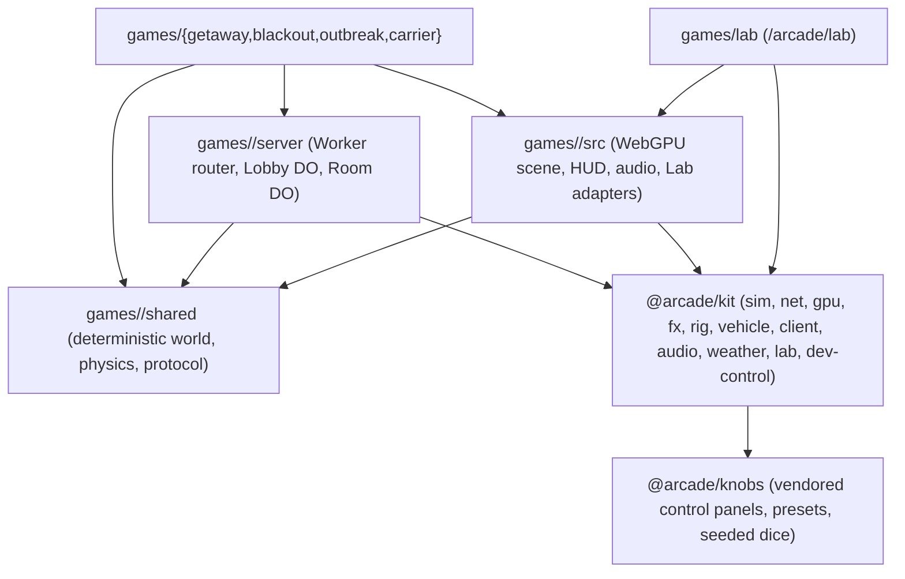
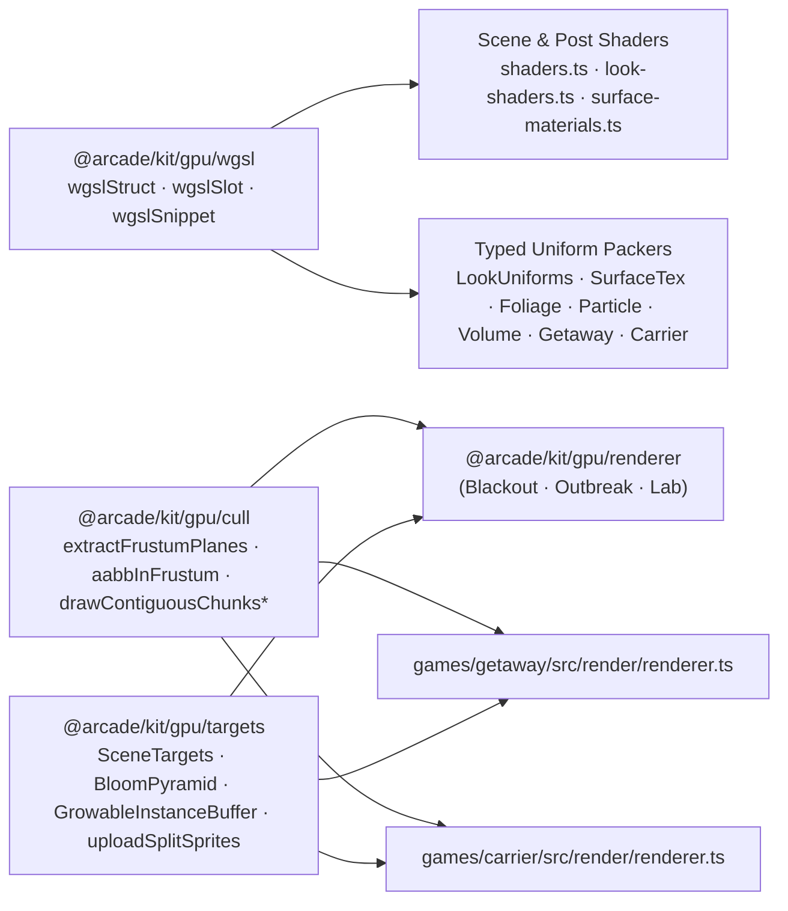

# Engine Architecture

`arcade` is a Bun workspace monorepo where one source package, `@arcade/kit` (`packages/kit/`, ~65k lines of TypeScript), and a vendored control-panel library, `@arcade/knobs` (`packages/knobs/`, ~17.5k lines), power four live WebGPU multiplayer games (`getaway`, `blackout`, `outbreak`, `carrier`) and the shared authoring workbench (`lab`). Every workspace package exports `.ts` source directly with no intermediate build step; Vite and Wrangler bundle only the modules each game imports. Game rules, procedural maps, meshes, HUDs, and art direction stay inside `games/<name>/`. `games/wings/`, `landing/`, and `redirects/` remain independent projects with their own lockfiles.

## 1. Engine Layers carry strict runtime boundaries

Each workspace game splits its code into three directories (`shared/`, `server/`, `src/`) over `@arcade/kit` and `@arcade/knobs`:

| Layer | Path | Runtime & constraints | What belongs here |
| :--- | :--- | :--- | :--- |
| **Shared game logic** | `games/<name>/shared/` | Pure ESNext (`window`, `document`, `WebSocket`, `DurableObject`, and `GPUDevice` are forbidden) | Fixed-tick world state (`stepWorld`), game rules, collision and combat math, procedural map/chunk generation, and wire message schemas. Runs identically in the browser client, the Cloudflare Durable Object, and `bun test`. |
| **Authoritative server** | `games/<name>/server/` | Cloudflare Workers & Durable Objects (`@cloudflare/workers-types`) | Worker URL prefix stripping (`/arcade/<name>`), `Lobby` Durable Object (backed by `@arcade/kit/sim/matchmaking` and `ctx.storage`), and `Room` Durable Object (fixed-tick loop, seat tokens, snapshot broadcast, and SQLite checkpoints in Outbreak). |
| **Browser client** | `games/<name>/src/` | Browser DOM, WebGPU, Web Audio | Entry loop (`main.ts`), game-specific scene and mesh builders, local/network session wiring, HUD, sound cues, and lazy Lab adapters (`src/lab/*`). |
| **Shared engine kit** | `packages/kit/` (`@arcade/kit/*`) | Subpath-scoped (`sim` and `net` are runtime-pure; `gpu`, `fx`, `client`, `audio`, `weather`, `lab`, and `dev-control` target the browser/dev server) | Reusable simulation, networking, WebGPU rendering, effects, character rigs, vehicle presentation, controls, audio, weather, the Lab workbench, and the `arcade` dev-control bridge. |
| **Control panels** | `packages/knobs/` (`@arcade/knobs`) | Browser DOM & optional WebGPU die | Vendored from Kit's `knobs` repository (`bun packages/knobs/scripts/sync.ts`; never edited in place). Draws every game's Backquote overlay, the Lab Details column, and station `controls` cards through `@arcade/kit/lab-knobs`. |

## 2. `@arcade/kit` is organized into ten subsystem areas

Instead of splitting shared code across separate npm packages with cross-package version drift, `@arcade/kit` exposes subpath exports (`@arcade/kit/sim/rng`, `@arcade/kit/gpu/renderer`, `@arcade/kit/net/prediction`) from a single `packages/kit/` workspace folder checked by `bun run check:packages`:

1. **`sim/` (`rng`, `geom`, `obb`, `ai`, `ledger`, `matchmaking`)**: Deterministic simulation building blocks. `rng.ts` provides `Rng`, `mulberry32`, `seedOf`, `hash2`, and `hash3`. `geom.ts` provides the CSR static rectangle grid (`RectGrid`), zero-allocation DDA `raycast`/`clearLine`, circle-rect `pushOut`, and `MinHeap`. `obb.ts` runs the 2D SAT two-point contact manifold and Box2D 2×2 block impulse solver in both `(x, z)` and `(x, y)` coordinates. `ai.ts` holds shared steering and sight helpers. `ledger.ts` implements the deterministic item store, container rules, and crafting engine used by Outbreak progression. `matchmaking.ts` provides `SharedMatchmaker`, room codes, and name sanitization across all multiplayer lobbies.
2. **`net/` (`bytes`, `seats`, `jitter-buffer`, `interest`, `rewind`, `interpolate`, `prediction`)**: Multiplayer transport, interest/delta management, and reconciliation primitives. `bytes.ts` packs binary frames, varints, angles, nibble pairs, bitsets, and shared prefixes. `seats.ts` separates public player IDs from private reconnect tokens. `jitter-buffer.ts` adapts playout delay while preserving one-shot input edges and bridging small packet-loss gaps. `interest.ts` provides per-recipient spatial interest bubbles, priority accumulation, `AckHistory` for delta compression against `ackSnapTick`, and `BandwidthPacer`. `rewind.ts` (`RewindHistory`) provides server-side lag-compensated hitscan rewind. `interpolate.ts` (`SnapshotBuffer`) interpolates remote entities between bracketed server snapshots, and `prediction.ts` (`Predictor`, `Smoother`) replays unacknowledged local inputs on server ack and decays position error exponentially.
3. **`gpu/` (`mesh`, `renderer`, `shaders`, `look-shaders`, `level`, `limits`, `motion`, `motion-blur`, `sprite-motion`, `surface-materials`, `foliage`), `look.ts`, `textures/`, `gpu-perf.ts`**: WebGPU rendering infrastructure. `mesh.ts` packs vertices into 24 bytes (`float32x3` position, `snorm8x4` normal, `unorm8x4` colour, `float16x2` material/aux). `renderer.ts`, `shaders.ts`, and `level.ts` run the shared polar-shadow compute pass, cutaway chunk router, 4× MSAA HDR target, and 5-level Jimenez bloom chain. `motion-blur.ts` and `motion.ts` provide the depth-aware 8-tap shutter gather and transform velocity history. `surface-materials.ts` and `textures/` supply procedural surface recipes and the 16-layer `256×256` WebP texture array. `foliage.ts` generates procedural trees, shrubs, hedges, and grass with actor trample bending. `look.ts` and `look-shaders.ts` define `LookSettings` presets and WGSL grading hooks. `gpu-perf.ts` (`PerfSampler`) formats rolling p50/p95/FPS and whole-frame GPU timestamp intervals.
4. **`fx/` (`particles`, `particle-renderer`, `volume*`, `smoke-trail`, `tyre-renderer`, `explosion`, `fire-water*`, `splatter*`, `frame-timer`)**: Fixed typed-array particle pools, rate and distance `Emitter`s, lit billboard/spark/debris rendering, four-connected BFS flood-fill volumetric smoke (`SmokeVolumes`), continuous ribbon tyre trails, multi-stage explosions, fire and water jets, and surface blood decals.
5. **`rig.ts`, `human-locomotion.ts`, `human-pose.ts`, `human-profile.ts`, `shamble-crouch.ts`, `pose-diff.ts`**: The shared procedural human rig ([human-rig.md](human-rig.md) and [animation.md](animation.md)), including planted-foot walk/run/sprint gait, zombie shamble and crouch, two-bone IK, semantic limb and prop detachment, and mocap pose-diff measurement.
6. **`vehicle/` (`chassis`, `body-pose`, `lights`, `emissions`, `fx`, `smoke-trail`, `smoke-renderer`, `sprites`, `audio/*`, `lab`)**: Presentation vehicle chassis spring/damper pose, wheel rotation, headlamp/taillamp mounts, tyre heat and skid emissions, and procedural drivetrain and nitro audio synthesis shared by Getaway and Blackout.
7. **`client/` (`controls`, `key-cap`, `input`, `camera`) and `orbit-gestures.ts`**: Physical `KeyboardEvent.code` bindings, QWERTY prompt labels (`keyLabel`) with opt-in layout labels, SVG/HTML key caps with hold progress rings (`keyCapHtml`, `keyPromptHtml`), top-down `Input` and `Camera`, and the unified 3D viewport gesture grammar (`orbit-gestures.ts`) shared across Lab, Catalogue, and Characters.
8. **`audio/` (`runtime`, `offline`, `synth`, `cues`, `emitters`, `library`, `manifest`, `lab`)**: Shared Web Audio graph, `OfflineAudioContext` renderer for deterministic node-graph and sample proofs, procedural sound synthesis, and the semantic sound library (`@arcade/kit/audio/library`, [sfx-library.md](sfx-library.md)).
9. **`weather/` (`settings`, `state`, `wgsl`, `renderer`)**: Continuous-phase weather simulation (`Clear`, `Drizzle`, `Rain`, `Storm`, `Fog`, `Snow`), wind gusts, multi-stroke lightning, progressive surface wetness, wet-surface WGSL hooks (`weatherSurfaceDeclarationsWgsl`), and GPU-instanced precipitation and splash rendering.
10. **`lab/`, `lab-panel.ts`, `lab-navigation.ts`, `lab-knobs.ts`, `lab-tuning.ts`, `dev-control.ts`, `lab-commands.ts`, `dev-hub*.ts`**: The standalone three-column Lab workbench (`Outliner`, `Details`, `Library` drawer, `⌘K` palette, `Watch` pins, 8-sector radial menu, transport, frozen-frame scrub, A/B split wipe, variation grid, and station workspaces), the floating game debug overlay (`LabPanel`), the shared `LabCommandRegistry`, the loopback `/__arcade/control` WebSocket bridge for the `arcade` CLI, single-tab Studio Tab Strip tours, and the local Dev Hub.

## 3. Shared module adoption across games

The table below shows which shared modules each game and the Lab import. `scripts/architecture-map.ts` generates this table from source imports, and `packages/kit/architecture-map.test.ts` checks it during `bun run check:packages` so it cannot drift. Run `bun scripts/architecture-map.ts --write` after adding or removing `@arcade/kit` imports in a game. (`Wings` is an independent Three.js project with its own lockfile and imports no `@arcade/kit` modules.)

<!-- ARCHITECTURE-MAP:START -->

| Shared module (`@arcade/kit` / `@arcade/knobs`) | Responsibility | Getaway | Blackout | Outbreak | Carrier | Lab | Wings |
| :--- | :--- | :---: | :---: | :---: | :---: | :---: | :---: |
| `sim/rng` | Seeded PRNG (`Rng`, `mulberry32`, `seedOf`, `hash2`, `hash3`) | Yes | Yes | Yes | Yes | Yes | — |
| `sim/geom` | `RectGrid`, DDA `raycast`/`clearLine`, `pushOut`, `MinHeap` | — | Yes | Yes | — | — | — |
| `sim/obb` | 2D SAT manifold and Box2D 2-point block impulse solver | Yes | Yes | — | — | — | — |
| `sim/ai` | Shared steering, sight checks, and tactical/zombie AI helpers | — | Yes | Yes | — | — | — |
| `sim/ledger` | Deterministic item store, containers, and crafting rule engine | — | — | Yes | — | — | — |
| `sim/matchmaking` | `SharedMatchmaker`, room codes, and player name sanitization | Yes | Yes | Yes | Yes | — | — |
| `net/*` | Binary framing, seat tokens, `JitterBuffer`, `SnapshotBuffer`, `Predictor`, `Smoother` | — | — | Yes | — | — | — |
| `gpu/wgsl` | Typed WGSL structs (`wgslStruct`), slot specialization (`wgslSlot`), and snippet composition | Yes | Yes | Yes | Yes | — | — |
| `gpu/mesh` | 24-byte packed vertex builder (`Mesh`, `packVerts`) | — | Yes | Yes | Yes | Yes | — |
| `gpu/{cull,targets}` | Frustum/rect chunk culling, contiguous draw merging, MSAA/HDR targets, and 5-level bloom | Yes | Yes | Yes | Yes | — | — |
| `gpu/{renderer,shaders,level,limits}` | Polar shadows, cutaway chunks, 4x MSAA HDR, and 5-level bloom | — | Yes | Yes | — | — | — |
| `gpu/{motion,motion-blur,sprite-motion}` | Depth-aware 8-tap shutter gather and actor/sprite velocity history | Yes | Yes | Yes | — | — | — |
| `gpu/{surface-materials,foliage}` & `textures` | Procedural surface recipes, 16-layer WebP array, foliage, and trample | — | Yes | Yes | — | Yes | — |
| `look` & `gpu/look-shaders` | `LookSettings` presets and WGSL scene/post grading hooks | — | Yes | Yes | — | Yes | — |
| `gpu-perf` & `fx/frame-timer` | Rolling p50/p95/FPS `PerfSampler` and GPU pass timestamp telemetry | Yes | Yes | Yes | Yes | Yes | — |
| `fx/{particles,particle-renderer}` | Fixed typed-array particle pool, `Emitter`, and billboard/spark/debris pass | Yes | Yes | Yes | Yes | Yes | — |
| `fx/{volume*,smoke-trail,tyre-renderer}` | Flood-fill volumetric smoke and continuous ribbon tyre trails | Yes | Yes | Yes | — | Yes | — |
| `fx/{explosion,fire-water,splatter*}` | Multi-stage explosions, fire/water jets, and surface blood decals | Yes | Yes | Yes | Yes | Yes | — |
| `rig` & `human-*` | Shared human skeleton, planted-foot gait, shamble, IK, detachment, pose-diff | — | Yes | Yes | — | — | — |
| `vehicle/*` | Presentation chassis pose, lamps, tyre emissions, and drivetrain/nitro synth | Yes | Yes | — | — | Yes | — |
| `client/{controls,key-cap,chat.css}` | Physical `KeyboardEvent.code` bindings, QWERTY labels, key-cap UI, and chat styling | Yes | Yes | Yes | Yes | Yes | — |
| `client/{input,camera}` & `orbit-gestures` | Top-down `Input`, `Camera` (trauma² shake, directional kick, `HitStop`), and orbit/pan/zoom gestures | — | Yes | Yes | — | Yes | — |
| `audio/*` | Web Audio runtime, offline renderer, procedural synth, and `sfx-library` | Yes | — | Yes | — | Yes | — |
| `weather/*` | Continuous-phase weather sim, wet-surface WGSL, and rain/snow/splash pass | — | — | Yes | — | Yes | — |
| `lab-panel` & `@arcade/knobs` | Backquote debug overlay and Lab Inspector drawn by `packages/knobs` | Yes | Yes | Yes | Yes | Yes | — |
| `lab/*` & `compare` | Lab workbench, sections, adapters, A/B compare, variation grid, and stations | Yes | Yes | Yes | — | Yes | — |
| `dev-control`, `lab-commands` & `dev-hub` | `LabCommandRegistry`, `/__arcade/control` bridge, `arcade` CLI, tours, and Dev Hub | Yes | Yes | Yes | Yes | Yes | — |

<!-- ARCHITECTURE-MAP:END -->

<!-- WORKSTREAM A: RENDERING SECTION START -->
## 4. Rendering

Workstream A (`engine-render`) unifies shader composition, typed uniform packing, and shared WebGPU pass primitives across `@arcade/kit/gpu/*`, `@arcade/kit/fx/*`, Getaway, Blackout, Outbreak, and Carrier.

### 4.1 Typed WGSL structs (`@arcade/kit/gpu/wgsl`)

All shared and game uniform blocks are defined once with `wgslStruct(name, fields)`:

- **Automatic WGSL std140/storage alignment**: Computes exact byte/float offsets (`vec3f` 16-byte alignment, `mat4x4f` 64-byte alignment, `array<vec4f, N>` stride, `@align(16)` on scalar-only uniform structs, and `@size(...)` tail padding so WGSL struct value constructors preserve exact field arity with zero synthetic `_pad_tail` fields).
- **Single-source WGSL + CPU packing**: Generates `.wgsl`, `.floatCount`, `.byteSize`, `.offsetOf(field)`, and `.pack(values, out, floatOffset)` across `LookUniformsStruct` (64 floats, replacing 27 `u0..u15` vector swizzles with named WGSL fields), `MaterialRecipeStruct`, `SurfaceTexUniformsStruct`, `FoliageWindConfigStruct`, `FoliageActorsStruct`, `ParticleFrameStruct` (`ParticleRenderer.setFrame`), `VolumeFrameStruct` (`VolumeRenderer.setFrame`), `GetawayFrameStruct`, `GetawayLightStruct`, `GetawayShadowFrameStruct`, `CarrierFrameStruct`, and `CarrierGradeStruct`.

### 4.2 Explicit shader composition & per-variant Look specialization

Shader assembly uses `wgslSnippet`, `wgslSlot`, `resolveWgsl`, and structured `SceneHooks` (`diffuseTerm`, `combineLighting`, `fragmentReturn`, `lookSurface`) with **zero `.replace()` or regex string mutations** on generated WGSL:

- **Surface material slot specialization (`asphaltConcreteSlot`)**: `buildSurfaceMaterialDeclarationsWgsl({ asphaltConcrete })` overrides the asphalt/concrete procedural evaluator via `wgslSlot` instead of regex-stripping `fn asphaltConcrete` in Outbreak's `ground.ts`.
- **Lazy per-variant Look pipelines (`lookVariantSlot`, `Renderer.ensureLookPipes`)**: Instead of compiling every style branch into one mega-shader, `look-shaders.ts` specializes `"noir"`, `"painterly"`, and `"generic"` variants on demand:
  - `"noir"` (`119,426 B` scene / `20,023 B` post, `1.6 ms` compile, 7 pipelines) strips `kuwaharaPost` and the Painterly gouache surface branch.
  - `"painterly"` (`119,404 B` scene / `21,364 B` post, `4.9 ms` compile, 7 pipelines) strips the Noir selective-colour branch.
  - `"generic"` (`119,782 B` scene / `21,364 B` post, `2.1 ms` compile, 7 pipelines) serves split-wipe comparisons and custom hybrid looks.

### 4.3 Converged GPU targets, bloom pyramid, and chunk culling (`@arcade/kit/gpu/{cull,targets}`)

All four WebGPU games share `@arcade/kit/gpu/cull` and `@arcade/kit/gpu/targets`:

| Primitive | Module | Responsibility | Adopted by |
| :--- | :--- | :--- | :--- |
| `extractFrustumPlanes`, `aabbInFrustum`, `boxIntersectsRect2D` | `@arcade/kit/gpu/cull` | Extracts 6 WebGPU `[0..1]` clip planes from a `mat4x4f` and tests 3D AABBs or 2D plan bounds | Getaway, Blackout, Outbreak, Carrier, Lab |
| `drawContiguousChunks`, `drawContiguousChunksByMode` | `@arcade/kit/gpu/cull` | Culls chunks and coalesces adjacent visible vertex ranges (`first + count === next.first`) into single `pass.draw` calls | Getaway, Blackout, Outbreak, Carrier, Lab |
| `SceneTargets` | `@arcade/kit/gpu/targets` | Owns the 4× MSAA colour, 4× MSAA depth, and resolved `rgba16float` HDR target lifecycle on `resize(w, h)` | Getaway, Blackout, Outbreak, Carrier, Lab |
| `BloomPyramid` | `@arcade/kit/gpu/targets` | Owns the 5-level HDR Jimenez 13-tap downsample / 3×3 tent upsample mip chain, texel-size uniform buffers, bind groups, and pass encoding | Getaway, Blackout, Outbreak, Carrier, Lab |
| `GrowableInstanceBuffer`, `uploadSplitSprites` | `@arcade/kit/gpu/targets` | 1.5× capacity growth, contiguous-slice single-`writeBuffer` coalescing, and split alpha/additive sprite buffer uploads | Getaway, Blackout, Outbreak, Lab |

### 4.4 Renderer boundaries across games

- **Blackout, Outbreak, and Lab** share `@arcade/kit/gpu/renderer` directly (polar 1D ray-cast shadow compute pass, optional temporal visibility field, `fsSolid` vs `levelCut` cutaway routing, 4× MSAA HDR pass, volumetric smoke/particles/splatter/weather, and `BloomPyramid` + `Look` composite).
- **Getaway** (`games/getaway/src/render/renderer.ts`) shares `@arcade/kit/gpu/{wgsl,cull,targets,motion-blur,sprite-motion}` and `@arcade/kit/fx/*` while retaining its `2048²` orthographic directional moon shadow pass and stencil-masked occluded-car silhouette pass (`depthCompare: "greater"`, `stencil != 1`).
- **Carrier** (`games/carrier/src/render/{renderer,post,frame}.ts`) shares `@arcade/kit/gpu/{wgsl,mesh,cull,targets}`, `@arcade/kit/gpu-perf`, and `@arcade/kit/fx/{particles,particle-renderer,explosion}` while retaining its reversed-Z (`depth32float`, `clearValue: 0`, `greater-equal`) `ScenePass` slot architecture (`sky → opaque → alpha`) required for its 40 km ocean horizon. See [rendering-techniques.md](rendering-techniques.md) and [game-notes.md](game-notes.md) for measured GPU pass costs.
<!-- WORKSTREAM A: RENDERING SECTION END -->

## 5. Core engine patterns

### Fixed-tick deterministic simulation

Authoritative gameplay runs at a fixed tick rate (`TICK_HZ` in `shared/`) using pure state transitions (`stepWorld(world, inputs, dt)`). Randomness inside `shared/` always draws from a seeded `Rng` (`@arcade/kit/sim/rng`), never `Math.random()`. Because `shared/` has zero browser or Worker dependencies, a solo/practice session in the browser and an authoritative multiplayer room in a Cloudflare Durable Object execute the exact same simulation code.

### Authoritative Durable Object rooms and client prediction

Each multiplayer game deploys a Cloudflare Worker (`arcade-<name>`) with two Durable Object classes:

1. **`Lobby`**: Persists active room summaries in `ctx.storage` and routes quick-join requests through `SharedMatchmaker` (`@arcade/kit/sim/matchmaking`).
2. **`Room`**: Owns the authoritative `World` state, WebSocket connections, reconnect grace windows, idle kick timers, and fixed-tick catchup (`MAX_CATCHUP`).

On the client (`@arcade/kit/net/*`, documented in [outbreak-coop.md](outbreak-coop.md)):
- Inbound client inputs pass through `JitterBuffer` so network jitter does not drop one-shot button edges (interact, attack, reload).
- The local player advances immediately via `Predictor` and reconciles on each server snapshot ack; `Smoother` decays residual positional snap over time without affecting authoritative coordinates.
- Remote actors and hordes render through `SnapshotBuffer` at `serverNow - interpolationDelay`, lerping between the two bracketing snapshots.

### Typed subsystem settings and Knobs / `LabPanel`

Every tunable visual, lighting, AI, physics, weather, or gameplay feel parameter lives in a typed settings object grouped by subsystem (`settings.lighting`, `settings.ai`, `settings.stamina`, `settings.flashlight`, `settings.ground`, `settings.zombies`) and bound to `LabPanel` (`@arcade/kit/lab-panel`, drawn by `@arcade/knobs`).

- **No look or feature query parameters**: URL query parameters (`?room=`, `?seed=`, `?peaceful=1`, `?bench=1`, `?station=`) are reserved for routing and automation. Visual and gameplay tunables belong in `LabPanel`.
- **Single write path and update boundaries**: Pointer drags, keyboard scrubs, exact numeric entry, group resets, seeded dice rolls (`tuningSeed`), and preset imports all route through `LabNavigation.set` and control `change` callbacks so live uniforms, spawn-time retriggers, and structural rebuilds fire consistently ([lab.md](lab.md#bind-controls-to-typed-production-settings)).
- **Versioned preset migration**: Exported presets and saved localStorage/URL recipes carry an explicit schema version and migrate legacy flat keys into subsystem namespaces before validation.

### Lab adapters and station registry

The standalone Lab (`games/lab`, served at `/arcade/lab/`) mounts the three-column workbench shell (`Outliner`, `Details`, `Library` drawer, top-bar transport, `⌘K` palette, and `Watch` list) over a single WebGPU device (`packages/kit/lab/`).

- **Game adapters (`games/lab/src/games/registry.ts`)**: Each game exports lazy chunked adapters for its effects, materials, spawnable characters/vehicles/props, and `LabAudioAdapter` (`games/<name>/src/lab/*`). Adapters invoke the game's production simulation, mesh builders, shaders, and audio graph rather than duplicating a Lab-only approximation.
- **Stations (`games/lab/src/stations/*.ts`)**: Saved demos that Kit returns to are defined with `defineStation({...})` ([lab.md](lab.md#stations)). Opening a station via `1`–`9`/`0`, `⌘K`, or `bun run arcade station <id>` loads the target section, runs its setup commands, and populates `left`, `right`, and `dock` widget slots (`status`, `controls` knobs cards, `variants`, `compare`, `perf`, `metrics`, `changes`, `notes`, `voice`). Pressing `N` records a Scrawl-style voice and drawing note that uploads keyframes, preset state, and Whisper transcription to the team board.

### Command registry, Dev Control, and proof scripts

Every interactive page registers its actions in a `LabCommandRegistry` (`@arcade/kit/lab-commands`) and connects to `/__arcade/control` during `bun run dev` (`@arcade/kit/dev-control`, [dev-control.md](dev-control.md)). UI buttons, keyboard shortcuts, the 8-sector radial menu, `⌘K` search, single-tab Studio Tours (`arcade tour`), pinned notes (`arcade note`), and `bun run arcade …` CLI commands all invoke the same registered command handlers.

Every change is verified across four layers:
1. **Package and game checks**: `bun run check:packages` and `bun run --cwd games/<name> check` (typecheck, unit tests, and production bundle smoke test).
2. **Deterministic simulation & wire proofs**: Seeded multi-tick simulation hashes (`prove.ts`, `coop.test.ts`, `bench-multiplayer.ts`) and mocap pose-diff scripts (`games/blackout/scripts/animation/`).
3. **Headless Metal browser proofs**: Playwright scripts executed via `hivemind run --kind browser -- <cmd>` verify `adapterInfo.vendor === "apple"`, zero console/page/WebGPU validation errors, offline audio graph equivalence (`prove-game-audio.ts`), station readiness (`prove-stations.ts`), and paired A/B GPU frame timestamps.
4. **Clean export & Worker dry-run**: `git archive` export with `bun install --frozen-lockfile`, all checks, and `bunx --no-install wrangler deploy --dry-run` per game.

## 6. Known gaps and staged roadmap

| Stage | Workstream | Problem | Target improvement |
| :--- | :--- | :--- | :--- |
| **Stage 1** | Workstream B (`engine-structure`) | `docs/architecture.md` described an unimplemented 2026-10-12 seven-package plan and 332-line `packages/kit`. | Rewrite `docs/architecture.md` as the current engine map with an automated shared-module usage table (`scripts/architecture-map.ts`), and update `docs/README.md` and `docs/shared-code.md` for Outbreak and Carrier. |
| **Stage 2** | Workstream B (`engine-structure`) | Flat merged settings bags in Outbreak (`src/main.ts` merges ~8 default objects via `Object.assign`, requiring `walkSpeed` vs `aiWalkSpeed` collision workarounds in `shared/session.ts`) and sibling games. | Namespace settings by subsystem (`settings.lighting`, `settings.ai`, `settings.stamina`, `settings.flashlight`, `settings.ground`, `settings.zombies`) with typed defaults, transparent `LabPanel`/knobs bindings, versioned preset migration, and zero collision workarounds. |
| **Stage 3** | Workstream B (`engine-structure`) | Multi-thousand-line files where parallel agents collide: `packages/kit/lab/workbench.ts` (6,272L), `packages/kit/dev-control.ts` (3,601L), `games/outbreak/src/main.ts` (2,050L), `games/blackout/src/game/game.ts` (1,748L), and Carrier's largest modules. | Split each file along existing seams into cohesive modules with small interfaces and zero behaviour change, coordinating with active Outbreak branches before splitting `games/outbreak/src/main.ts`. |
| **Render** | Workstream A (`engine-render`) | Duplicated WGSL snippets, uniform packing offsets, and effect renderers across Getaway, Carrier, Blackout, and Outbreak. | Converge shaders, typed uniform writers, and effect renderers in `@arcade/kit/gpu` and `@arcade/kit/fx`. |
| **Follow-up** | Shared server & net | Room Durable Object lifecycle boilerplate (throttled lobby reports, idle kick countdown, `BUILD` handshake) is still per-game; Getaway and Blackout have not yet migrated their client netcode to `@arcade/kit/net/*`. | Extract shared `Room` DO lifecycle helpers and adopt `@arcade/kit/net/*` in Getaway and Blackout when their netcode is next touched. |
