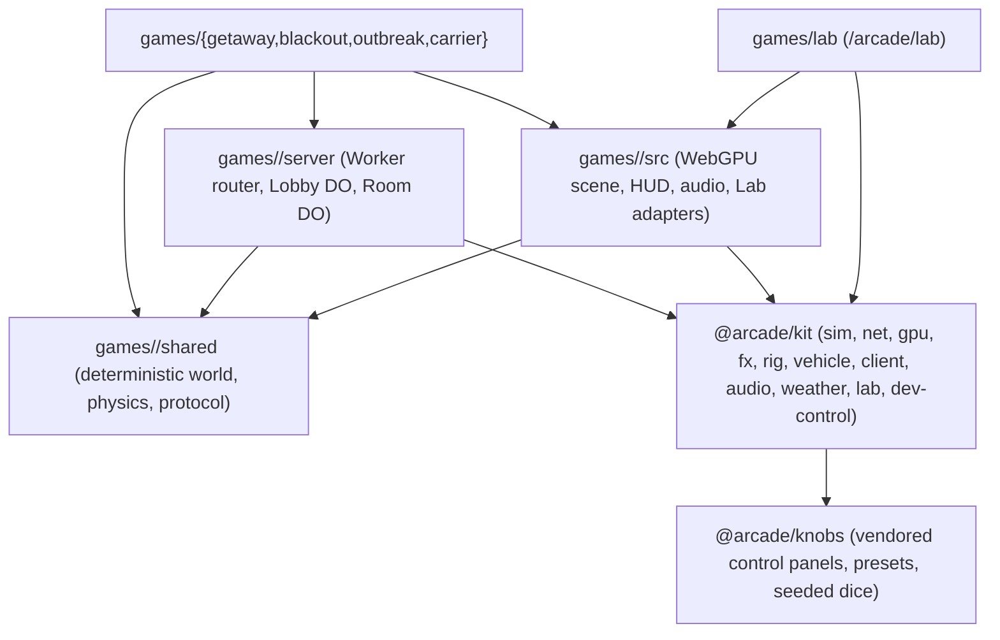

# Engine Architecture

`arcade` is a Bun workspace monorepo where one source package, `@arcade/kit` (`packages/kit/`, ~65k lines of TypeScript), and a vendored control-panel library, `@arcade/knobs` (`packages/knobs/`, ~17.5k lines), power four live WebGPU multiplayer games (`getaway`, `blackout`, `outbreak`, `carrier`) and the shared authoring workbench (`lab`). Every workspace package exports `.ts` source directly with no intermediate build step; Vite and Wrangler bundle only the modules each game imports. Game rules, procedural maps, meshes, HUDs, and art direction stay inside `games/<name>/`. `games/wings/`, `landing/`, and `redirects/` remain independent projects with their own lockfiles.

## 1. Engine Layers carry strict runtime boundaries

Each workspace game splits its code into three directories (`shared/`, `server/`, `src/`) over `@arcade/kit` and `@arcade/knobs`:

| Layer | Path | Runtime & constraints | What belongs here |
| :--- | :--- | :--- | :--- |
| **Shared game logic** | `games/<name>/shared/` | Pure ESNext (`window`, `document`, `WebSocket`, `DurableObject`, and `GPUDevice` are forbidden) | Fixed-tick world state (`stepWorld`), game rules, collision and combat math, procedural map/chunk generation, and wire message schemas. Runs identically in the browser client, the Cloudflare Durable Object, and `bun test`. |
| **Authoritative server** | `games/<name>/server/` | Cloudflare Workers & Durable Objects (`@cloudflare/workers-types`) | Worker URL prefix stripping (`/arcade/<name>`), `Lobby` Durable Object (backed by `@arcade/kit/sim/matchmaking` and `ctx.storage`), and `Room` Durable Object (fixed-tick loop, seat tokens, snapshot broadcast, and SQLite checkpoints in Outbreak). |
| **Browser client** | `games/<name>/src/` | Browser DOM, WebGPU, Web Audio | Entry loop (`main.ts`), game-specific scene and mesh builders, local/network session wiring, HUD, sound cues, and lazy Lab adapters (`src/lab/*`). |
| **Shared engine kit** | `packages/kit/` (`@arcade/kit/*`) | Subpath-scoped (`sim` and `net` are runtime-pure; `gpu`, `fx`, `client`, `audio`, `weather`, `lab`, and `dev-control` target the browser/dev server) | Reusable simulation, networking, WebGPU rendering, effects, character rigs, vehicle presentation, controls, audio, weather, the Lab workbench, and the `arcade` dev-control bridge. |
| **Control panels** | `packages/knobs/` (`@arcade/knobs`) | Browser DOM & optional WebGPU die | Vendored from Kit's `knobs` repository (`bun packages/knobs/scripts/sync.ts`; never edited in place). Draws every game's Backquote overlay, the Lab Details column, and station `controls` cards through `@arcade/kit/lab-knobs`. |

## 2. `@arcade/kit` is organized into ten subsystem areas

Instead of splitting shared code across separate npm packages with cross-package version drift, `@arcade/kit` exposes subpath exports (`@arcade/kit/sim/rng`, `@arcade/kit/gpu/renderer`, `@arcade/kit/net/prediction`) from a single `packages/kit/` workspace folder checked by `bun run check:packages`:

1. **`sim/` (`rng`, `geom`, `obb`, `ai`, `ledger`, `matchmaking`)**: Deterministic simulation building blocks. `rng.ts` provides `Rng`, `mulberry32`, `seedOf`, `hash2`, and `hash3`. `geom.ts` provides the CSR static rectangle grid (`RectGrid`), zero-allocation DDA `raycast`/`clearLine`, circle-rect `pushOut`, and `MinHeap`. `obb.ts` runs the 2D SAT two-point contact manifold and Box2D 2×2 block impulse solver in both `(x, z)` and `(x, y)` coordinates. `ai.ts` holds shared steering and sight helpers. `ledger.ts` implements the deterministic item store, container rules, and crafting engine used by Outbreak progression. `matchmaking.ts` provides `SharedMatchmaker`, room codes, and name sanitization across all multiplayer lobbies.
2. **`net/` (`bytes`, `seats`, `jitter-buffer`, `interest`, `rewind`, `interpolate`, `prediction`)**: Multiplayer transport, interest/delta management, and reconciliation primitives. `bytes.ts` packs binary frames, varints, angles, nibble pairs, bitsets, and shared prefixes. `seats.ts` separates public player IDs from private reconnect tokens. `jitter-buffer.ts` adapts playout delay while preserving one-shot input edges and bridging small packet-loss gaps. `interest.ts` provides per-recipient spatial interest bubbles, priority accumulation, `AckHistory` for delta compression against `ackSnapTick`, and `BandwidthPacer`. `rewind.ts` (`RewindHistory`) provides server-side lag-compensated hitscan rewind. `interpolate.ts` (`SnapshotBuffer`) interpolates remote entities between bracketed server snapshots, and `prediction.ts` (`Predictor`, `Smoother`) replays unacknowledged local inputs on server ack and decays position error exponentially.
3. **`gpu/` (`mesh`, `renderer`, `shaders`, `look-shaders`, `level`, `limits`, `motion`, `motion-blur`, `sprite-motion`, `surface-materials`, `foliage`), `look.ts`, `textures/`, `gpu-perf.ts`**: WebGPU rendering infrastructure. `mesh.ts` packs vertices into 24 bytes (`float32x3` position, `snorm8x4` normal, `unorm8x4` colour, `float16x2` material/aux). `renderer.ts`, `shaders.ts`, and `level.ts` run the shared polar-shadow compute pass, cutaway chunk router, 4× MSAA HDR target, and 5-level Jimenez bloom chain. `motion-blur.ts` and `motion.ts` provide the depth-aware 8-tap shutter gather and transform velocity history. `surface-materials.ts` and `textures/` supply procedural surface recipes and the 16-layer `256×256` WebP texture array. `foliage.ts` generates procedural trees, shrubs, hedges, and grass with actor trample bending. `look.ts` and `look-shaders.ts` define `LookSettings` presets and WGSL grading hooks. `gpu-perf.ts` (`PerfSampler`) formats rolling p50/p95/FPS and whole-frame GPU timestamp intervals.
4. **`fx/` (`particles`, `particle-renderer`, `volume*`, `smoke-trail`, `tyre-renderer`, `explosion`, `fire-water*`, `splatter*`, `skids`, `skid-renderer`, `frame-timer`)**: Fixed typed-array particle pools, rate and distance `Emitter`s, lit billboard/spark/debris rendering, four-connected BFS flood-fill volumetric smoke (`SmokeVolumes`), continuous ribbon tyre trails, persistent multiplied skid-mark decals, multi-stage explosions, fire and water jets, and surface blood decals.
5. **`rig.ts`, `human-locomotion.ts`, `human-pose.ts`, `human-profile.ts`, `shamble-crouch.ts`, `pose-diff.ts`**: The shared procedural human rig ([human-rig.md](human-rig.md) and [animation.md](animation.md)), including planted-foot walk/run/sprint gait, zombie shamble and crouch, two-bone IK, semantic limb and prop detachment, and mocap pose-diff measurement.
6. **`vehicle/` (`chassis`, `body-pose`, `lights`, `emissions`, `slip`, `driving-fx`, `fx`, `smoke-trail`, `smoke-renderer`, `sprites`, `audio/*`, `lab`)**: Presentation vehicle chassis spring/damper pose, wheel rotation, headlamp/taillamp mounts, per-wheel slip estimation, tyre heat, skid and smoke emissions by surface, the shared Driving FX Lab group, and procedural drivetrain and nitro audio synthesis shared by Getaway, Blackout and Outbreak.
7. **`client/` (`controls`, `key-cap`, `input`, `camera`) and `orbit-gestures.ts`**: Physical `KeyboardEvent.code` bindings, QWERTY prompt labels (`keyLabel`) with opt-in layout labels, SVG/HTML key caps with hold progress rings (`keyCapHtml`, `keyPromptHtml`), top-down `Input` and `Camera`, and the unified 3D viewport gesture grammar (`orbit-gestures.ts`) shared across Lab, Catalogue, and Characters.
8. **`audio/` (`runtime`, `offline`, `synth`, `cues`, `emitters`, `library`, `manifest`, `lab`)**: Shared Web Audio graph, `OfflineAudioContext` renderer for deterministic node-graph and sample proofs, procedural sound synthesis, and the semantic sound library (`@arcade/kit/audio/library`, [sfx-library.md](sfx-library.md)).
9. **`weather/` (`settings`, `state`, `wgsl`, `renderer`)**: Continuous-phase weather simulation (`Clear`, `Drizzle`, `Rain`, `Storm`, `Fog`, `Snow`), wind gusts, multi-stroke lightning, progressive surface wetness, wet-surface WGSL hooks (`weatherSurfaceDeclarationsWgsl`), and GPU-instanced precipitation and splash rendering.
10. **`lab/`, `lab-panel.ts`, `lab-navigation.ts`, `lab-knobs.ts`, `lab-tuning.ts`, `dev-control.ts`, `lab-commands.ts`, `dev-hub*.ts`**: The standalone three-column Lab workbench (`Outliner`, `Details`, `Library` drawer, `⌘K` palette, `Watch` pins, 8-sector radial menu, transport, frozen-frame scrub, A/B split wipe, variation grid, and station workspaces), the floating game debug overlay (`LabPanel`), the shared `LabCommandRegistry`, the loopback `/__arcade/control` WebSocket bridge for the `arcade` CLI, single-tab Studio Tab Strip tours, and the local Dev Hub.

## 3. Shared module adoption across games

The table below shows which shared modules each game and the Lab import. `scripts/architecture-map.ts` generates this table from source imports, and `packages/kit/architecture-map.test.ts` checks it during `bun run check:packages` so it cannot drift. Run `bun scripts/architecture-map.ts --write` after adding or removing `@arcade/kit` imports in a game. (`Wings` is an independent Three.js project with its own lockfile and imports no `@arcade/kit` modules.)

<!-- ARCHITECTURE-MAP:START -->

| Shared module (`@arcade/kit` / `@arcade/knobs`) | Responsibility | Getaway | Blackout | Outbreak | Carrier | Lab | Wings | Brawl |
| :--- | :--- | :---: | :---: | :---: | :---: | :---: | :---: | :---: |
| `sim/rng` | Seeded PRNG (`Rng`, `mulberry32`, `seedOf`, `hash2`, `hash3`) | Yes | Yes | Yes | Yes | Yes | — | Yes |
| `sim/geom` | `RectGrid`, DDA `raycast`/`clearLine`, `pushOut`, `MinHeap` | — | Yes | Yes | — | — | — | Yes |
| `sim/obb` | 2D SAT manifold and Box2D 2-point block impulse solver | Yes | Yes | Yes | — | — | — | — |
| `sim/ai` | Shared steering, sight checks, and tactical/zombie AI helpers | — | Yes | Yes | — | — | — | — |
| `sim/flow-field` | Shared per-goal flow fields (`FlowFieldCache`) over `GridNav` flat grids or chunk tiles | — | — | Yes | — | — | — | — |
| `sim/ledger` | Deterministic item store, containers, and crafting rule engine | — | — | Yes | — | — | — | — |
| `sim/matchmaking` | `SharedMatchmaker`, room codes, and player name sanitization | Yes | Yes | Yes | Yes | — | — | Yes |
| `sim/move` | Top-down circle body step with eased velocity and substepped push-out | — | Yes | — | — | — | — | Yes |
| `sim/{abilities,props,boids}` | Data-driven, server-authoritative abilities (casts, projectiles, swarms, zones, dashes, grabs), shoveable OBB props, and a presentation boids flock | — | — | — | — | — | — | Yes |
| `server/*` | Room and Lobby Durable Objects (`RoomObject`, `LobbyObject`) and the room game Worker router | — | Yes | — | — | — | — | Yes |
| `net/*` | Room seats/idle/tick core and client socket, binary framing, seat tokens, `JitterBuffer`, `SnapshotBuffer`, `Predictor`, `Smoother` | — | Yes | Yes | — | — | — | Yes |
| `gpu/wgsl` | Typed WGSL structs (`wgslStruct`), slot specialization (`wgslSlot`), and snippet composition | Yes | Yes | Yes | Yes | Yes | — | Yes |
| `gpu/mesh` | 24-byte packed vertex builder (`Mesh`, `packVerts`) | — | Yes | Yes | Yes | Yes | — | Yes |
| `gpu/{cull,targets,pass-graph}` | Frustum/shadow-sweep culling, contiguous draw merging, `ScenePass` slots, MSAA/HDR targets, and 5-level bloom | Yes | Yes | Yes | Yes | Yes | — | Yes |
| `gpu/{renderer,shaders,level}` & `limits` | Polar shadows, cutaway chunks, 4x MSAA HDR, and 5-level bloom | — | Yes | Yes | — | Yes | — | Yes |
| `gpu/{boot,scene-frame}` | WebGPU canvas boot, and frame inputs for small arenas: placed lights, box occluders, flat floor lighting | — | Yes | — | — | — | — | Yes |
| `gpu/{motion,motion-blur,sprite-motion}` | Depth-aware 8-tap shutter gather and actor/sprite velocity history | Yes | Yes | Yes | — | Yes | — | Yes |
| `gpu/{surface-materials,foliage}` & `textures` | Procedural surface recipes, 16-layer WebP array, foliage, and trample | — | Yes | Yes | — | Yes | — | Yes |
| `look` & `gpu/look-shaders` | `LookSettings` presets and WGSL scene/post grading hooks | — | Yes | Yes | — | Yes | — | Yes |
| `gpu-perf`, `fx/frame-timer` & `quality` | Rolling p50/p95/FPS `PerfSampler`, GPU pass timestamp telemetry and adaptive quality tiers (`GameQuality`) | Yes | Yes | Yes | Yes | Yes | — | Yes |
| `fx/{particles,particle-renderer}` | Fixed typed-array particle pool, `Emitter`, and billboard/spark/debris pass | Yes | Yes | Yes | Yes | Yes | — | Yes |
| `fx/{volume*,smoke-trail,tyre-renderer}` | Flood-fill volumetric smoke and continuous ribbon tyre trails | Yes | Yes | Yes | — | Yes | — | — |
| `fx/{explosion,projectile-trail,fire-water,splatter*}` | Multi-stage explosions with trailing fragments and water splashes, fire/water jets, and surface blood decals | Yes | Yes | Yes | Yes | Yes | — | Yes |
| `rig` & `human-*` | Shared human skeleton, planted-foot gait, shamble, IK, detachment, pose-diff | — | Yes | Yes | — | Yes | — | Yes |
| `avatar/*` | Top-down human avatar adapter: soldier, wizard, zombie and skeleton meshes, weapon clips, ragdolls | — | Yes | — | — | — | — | Yes |
| `vehicle/*` | Presentation chassis pose, lamps, tyre emissions, and drivetrain/nitro synth | Yes | Yes | Yes | — | Yes | — | — |
| `client/{controls,key-cap,chat.css}` | Physical `KeyboardEvent.code` bindings, QWERTY labels, key-cap UI, and chat styling | Yes | Yes | Yes | Yes | Yes | — | Yes |
| `client/{input,camera,smooth}` & `orbit-gestures` | Top-down `Input`, `Camera` (trauma² shake, directional kick, `HitStop`), and orbit/pan/zoom gestures | — | Yes | Yes | — | Yes | — | Yes |
| `audio/*` | Web Audio runtime, offline renderer, procedural synth, and `sfx-library` | Yes | — | Yes | — | Yes | — | Yes |
| `weather/*` | Continuous-phase weather sim, wet-surface WGSL, and rain/snow/splash pass | — | — | Yes | — | Yes | — | — |
| `lab-panel` & `@arcade/knobs` | Backquote debug overlay and Lab Inspector drawn by `packages/knobs` | Yes | Yes | Yes | Yes | Yes | — | Yes |
| `ramps` & `ramp-table` | Gradient and curve settings kept as JSON text, baked into lookup tables for per-frame reads | — | — | Yes | — | Yes | — | — |
| `lab/*` & `compare` | Lab workbench, sections, adapters, A/B compare, variation grid, and stations | Yes | Yes | Yes | — | Yes | — | — |
| `dev-control`, `lab-commands` & `dev-hub` | `LabCommandRegistry`, `/__arcade/control` bridge, `arcade` CLI, tours, and Dev Hub | Yes | Yes | Yes | Yes | Yes | — | Yes |

<!-- ARCHITECTURE-MAP:END -->

<!-- WORKSTREAM A: RENDERING SECTION START -->
## 4. Rendering

Workstream A (`engine-render`) converges Arcade's three WebGPU renderers into **one unified rendering foundation in `@arcade/kit/gpu`** that retains the strongest capabilities of each game's renderer:

- **From the Kit Renderer (`@arcade/kit/gpu/renderer`, Outbreak & Blackout)**: 24-byte `VERT_BYTES` vertex layout (`float32x3` pos, `snorm8x4` normal, `unorm8x4` color+`aOpenTone`, `float16x2` mat/aux), GPU polar 1D ray-cast local shadows (`512` rays × `64` lights) with partial-height furniture blockers, temporal compute visibility field (`VisibilityFieldShader`), baked 2D indirect bounce (`bounceTex`) and floor contact AO (`floorTex`), occupancy-gated roof cutaway and 4 m Z-banded Bayer-dithered wall cutaway (`fsSolid` vs `levelCut`), footprint-filtered (`fwidth`) procedural surface recipes + 16-layer `256²` WebP texture array (`sampleMaterialFast` in `postLightMaterial`), two-stage vertex wind + 8-actor foliage trample (`foliage.ts`), corner-safe volumetric smoke + half-res scissor-bounded flashlight shafts, and the opt-in `LookSettings` grading pipeline (`Noir`, `Painterly`, `Dusk`, `Sodium 70s`, `Golden Hour`) with lazy per-variant WGSL specialization.
- **From Getaway (`games/getaway/src/render/renderer.ts`)**: Frustum-swept `2048²` texel-snapped orthographic directional sun/moon shadow pass (`DirectionalShadowPass` + `texelSnappedOrthoLightMatrix` + `isShadowCasterVisible`, usable as a `ScenePass`), stencil-masked occluded vehicle/actor ghost silhouettes (`depthCompare: "greater"`, `stencil != 1`), half-resolution per-instance/per-sprite velocity buffer + 8-tap depth-aware shutter motion blur (`MotionBlur`, `PreviousTransforms`, `+0.23 ms` at 1440p) with nitro radial burst and lazily compiled `motionPipes`, alpha-weighted decal atlas mips (`uploadAlphaWeightedMipChain`), and world-space additive spotlight beams.
- **From Carrier (`games/carrier/src/render/`)**: Composable `ScenePass` plugin architecture (`prepare?(enc)` + `draw(pass)` in ordered `"sky" → "opaque" → "alpha"` slots via `PassList` with `@group(0)` Frame bound), configurable `PassContext` depth convention including reversed-Z `depth32float` (`clearValue: 0`, `greater-equal`) for 40 km horizons with zero Z-fighting, pre-allocated `colorAttachment`/`depthAttachment`/`mainPass` descriptors mutated in place on resize/render (zero per-frame descriptor allocations), analytical Gerstner wave + seabed refraction/foam shading, and physical day-night atmosphere helpers (`skyColor`, `hazeColor`, `applyFog`).

### 4.1 Capability Matrix Across Renderers

| Capability | Kit Renderer (`Outbreak` / `Blackout` / `Lab`) | Getaway Renderer | Carrier Renderer | Best-in-Class Source | Target Home in `@arcade/kit/gpu` |
| :--- | :--- | :--- | :--- | :--- | :--- |
| **Pass extensibility & zero-alloc descriptors** | `PassList` slots + pre-allocated `SceneTargets.mainPass` | `PassList` slots + pre-allocated `SceneTargets.mainPass` | **`ScenePass` plugin slots (`sky → opaque → alpha`) + in-place `mainPass` descriptors** | **Carrier** | `@arcade/kit/gpu/pass-graph` (`ScenePass`, `PassList`, `PassContext`) & `@arcade/kit/gpu/targets` (`SceneTargets.configureMainPass`) |
| **Depth buffer modes** | `depth24plus` (`less-equal`, clear `1`) | **`depth24plus-stencil8` (`less`, stencil ref `1`)** | **Reversed-Z `depth32float` (`greater-equal`, clear `0`, 40 km far)** | **Carrier** (far horizon) & **Getaway** (stencil) | `@arcade/kit/gpu/pass-graph` (`DepthMode`: `"standard" \| "stencil" \| "reversed-z"`) |
| **Compact vertex format** | **`24 B` `VERT_BYTES` (`f32x3` pos, `snorm8x4` nrm, `unorm8x4` col+AO, `f16x2` mat/aux)** | `48 B` (`12 × f32`) | **`24 B` `VERT_BYTES` (`packVerts`)** | **Kit Renderer & Carrier** | `@arcade/kit/gpu/mesh` (`VERT_BYTES = 24`, `packVerts`) |
| **Local practical shadows** | **GPU polar 1D ray-cast (`512` rays × `64` lights, partial-height blockers, 5/9-tap PCF)** | Unshadowed point/cone loop | Unshadowed deck/navigation lights | **Kit Renderer** | `@arcade/kit/gpu/shaders` (`polarShader`, `shadowAt`, `partialShadow`) |
| **Directional sun/moon shadows** | Baked static R8 `moonTex` mask + opt-in `DirectionalShadowPass` | **Texel-snapped `2048²` `depth32float` `DirectionalShadowPass` + 9-tap PCF + shadow-sweep culling** | Analytical sun diffuse + horizon self-shadow | **Getaway** | `@arcade/kit/gpu/pass-graph` (`DirectionalShadowPass`, `texelSnappedOrthoLightMatrix`) + `@arcade/kit/gpu/cull` (`isShadowCasterVisible`) |
| **Indirect GI & contact AO** | **Dijkstra 2D `bounceTex` + `floorTex.r` AO + Jimenez multi-bounce polynomial** | Vertex room tints + wheel-weighted car contact decal (`kind == 9`) | Hemisphere sky/sea bounce | **Kit Renderer** & **Getaway** | `@arcade/kit/gpu/shaders` (`bounceAt`, `shadeScene`) + analytical contact decals |
| **Surface materials & textures** | **6 `fwidth` procedural recipes + 16-layer `256²` WebP array (`sampleMaterialFast` after `lightSum`)** | CPU alpha-weighted decal atlas (`uploadAlphaWeightedMipChain`) + window material | Packed 24-byte `MAT` (`lit`, `glow`, `foliage`) | **Kit Renderer** & **Getaway** | `@arcade/kit/gpu/surface-materials` + `@arcade/kit/textures` + `@arcade/kit/gpu/targets` |
| **Vegetation & interactive wind** | **Curved 3D grass, dome-normal leaf mounds/rosettes, 2-stage wind, 8-actor trample** | Static city trees | Swaying island foliage stream (`splitFoliage`) | **Kit Renderer** | `@arcade/kit/gpu/foliage` (`FoliageWindConfigStruct`, `FoliageActorsStruct`) |
| **Ocean, sky & long-range fog** | Plan-distance height fog | Exponential distance fog | **Gerstner swell/chop, seabed refraction, `skyColor`/`hazeColor`/`applyFog`, clouds/stars** | **Carrier** | Carrier `OceanPass` / `SkyPass` / `CloudsPass` (`ScenePass` plugins) + shared atmosphere WGSL |
| **Cutaway & occluded readability** | **Occupancy roof cutaway + 4 m Z-banded Bayer-dithered `levelCut` walls + `exploredTex` memory** | **Stencil-masked occluded car ghost silhouette (`fsGhost`, `STENCIL_GHOST_FACE`)** | Unoccluded open sea/air | **Kit Renderer** (cutaway) & **Getaway** (stencil ghost) | `@arcade/kit/gpu/renderer` (`levelCut` routing) + `@arcade/kit/gpu/pass-graph` (`STENCIL_OCCLUDER_FACE`, `STENCIL_GHOST_FACE`) |
| **Volumetrics & combat FX** | **Flood-fill `SmokeVolumes`, half-res scissor `drawVolume` flashlight shaft, `SplatterRenderer`, `ParticleRenderer`, `WeatherRenderer`** | `SmokeVolumes`, `ParticleRenderer`, ribbon `SmokeRenderer`, heli `setBeams` | `ParticleRenderer`, multi-stage ship/jet explosions, `RainPass` | **Kit Renderer** & `@arcade/kit/fx` | `@arcade/kit/fx/*` + `@arcade/kit/weather` + `@arcade/kit/gpu/renderer` |
| **Motion blur** | Shared `MotionBlur` (camera + burst) & lazy `ensureMotionPipes()` | **Half-res `Velocity` pass (`+0.23 ms`) + `PreviousTransforms` + 8-tap depth-aware shutter gather + nitro radial boost** | None | **Getaway** & `@arcade/kit/gpu/motion-blur` | `@arcade/kit/gpu/motion-blur` + `@arcade/kit/gpu/motion` |
| **Post-processing & Look grading** | **5-level `BloomPyramid` + 6 `LookSettings` presets (4 tonemappers, Kuwahara, outlines, halation, split-wipe) + per-variant WGSL** | 5-level `BloomPyramid` + ACES + chromatic fringe | 5-level `BloomPyramid` + Hill ACES (`1.6×` exposure) + sRGB + grain | **Kit Renderer** | `@arcade/kit/gpu/targets` (`BloomPyramid`) + `@arcade/kit/gpu/look-shaders` |
| **Chunk streaming & culling** | **9-slot `STREAM_SLOT_BYTES` world ring + 2D rect culling + mode-grouped contiguous draw merging** | **6-plane 3D frustum + shadow-sweep culling + contiguous draw merging** | 2D ground-rect frustum culling + contiguous draw merging | **All three (converged)** | `@arcade/kit/gpu/cull` (`extractFrustumPlanes`, `aabbInFrustum`, `boxIntersectsRect2D`, `drawContiguousChunks*`) |
| **GPU frame pacing & telemetry** | **Single-in-flight `installFramePacer` + `FrameTimer` whole-frame GPU timestamps + `PerfSampler` p50/p95** | `FrameTimer` + `GpuPerf` | Single-in-flight `installFramePacer` | **Kit Renderer** | `@arcade/kit/gpu-perf` + `@arcade/kit/fx/frame-timer` |

### 4.2 Target Unified Frame Graph & Pass Schedule

Every frame executes a deterministic 7-stage pass schedule over `@arcade/kit/gpu/targets` (`SceneTargets` + `BloomPyramid`) and `@arcade/kit/gpu/pass-graph` (`PassList`). Stages with zero active work are skipped with zero GPU pass overhead:

```mermaid
flowchart TD
  Prep["1. Pre-Pass Prepare\npasses.prepareAll(enc) · particle/splatter/weather uploads"]
  Shadow["2. Shadow & Visibility Passes\n• Polar 1D ray-cast compute (512 rays × N lights) + VisibilityField compute\n• Optional 2048² depth32float directional shadow pass (isShadowCasterVisible + drawContiguousChunks)"]
  Main["3. Main 4× MSAA HDR Scene Pass (SceneTargets: rgba16float + DepthMode)\n① sky slot passes (SkyPass, StarsPass, CloudsPass)\n② Static world: fsSolid chunks (drawContiguousChunks*) → levelCut cutaway chunks\n③ Opaque instanced models (stencil=1 when DepthMode='stencil') + opaque slot passes (Ocean, Ship, Vehicles)\n④ Translucent glass chunks + instanced alpha + alpha sprites + tyre smoke + additive sprites/beams\n⑤ Stencil-masked occluded ghost silhouettes (depth > scene, stencil != 1)\n⑥ SplatterRenderer → ParticleRenderer → WeatherRenderer → alpha slot passes"]
  Vol["4. Half-Res Depth-Aware Volumetrics (loadOp: 'load' on hdrView)\n• SmokeVolumes 24-step ray-march + 4-tap bilateral upsample\n• Scissor-bounded half-res volumetric flashlight/beam shaft (drawVolume)"]
  Blur["5. Velocity & Depth-Aware 8-Tap Shutter Motion Blur\n• Camera + per-instance/sprite velocity pass → 8-tap depth-gated gather + feel/nitro burst"]
  Bloom["6. 5-Level Jimenez HDR Bloom Pyramid (BloomPyramid)\n• 5× 13-tap downsample passes (soft-knee threshold on mip 0)\n• 4× additive 3×3 tent upsample passes"]
  Comp["7. Per-Variant Look & Display Composite\n• Lazy specialized variant ('noir' | 'painterly' | 'generic' | baseline)\n• Tonemap (ACES / Filmic / AgX / Hue-Preserving) + split-tone + grain + 8-bit IGN dither"]

  Prep --> Shadow --> Main --> Vol --> Blur --> Bloom --> Comp
```

#### Apple Silicon TBDR tile-memory invariants

1. **Strict `fsSolid` vs `fs` (`discard`) separation**: Opaque world chunks, grass, trees, furniture, and instanced actors bind `fsSolid` (zero `discard` statements) so Apple Silicon hardware Hidden-Surface Removal (HSR / early-Z) stays active. Only chunks intersecting the live player/peek cutaway box switch to `levelCut` (`fs`) via `drawContiguousChunksByMode`.
2. **Transient MSAA & conditional depth store**: `SceneTargets` allocates `msaa` with `GPUTextureUsage.RENDER_ATTACHMENT` only (`loadOp: "clear"`, `storeOp: "discard"`, resolved in tile memory to `hdrView`). `depthStoreOp` is `"discard"` unless stage 4 (`SmokeVolumes`) or stage 5 (`MotionBlur`) is active on that frame, avoiding a `104.7 MB` 4× MSAA depth flush at 4K.
3. **Post-light material evaluation (`postLightMaterial`)**: `lightSum` runs first using base geometry normals; `sampleMaterialFast` (`texture_2d_array` with compile-time constant layer indices) runs after the light loop so texture coordinates and material locals never overlap the 36-register polar shadow loop.

### 4.3 Resource Management, Typed WGSL, Variants, Culling & Telemetry

- **Typed WGSL structs (`@arcade/kit/gpu/wgsl`)**: `wgslStruct(name, fields)` computes std140/storage alignment (`vec3f` 16-byte alignment, `mat4x4f` 64-byte alignment, `array<vec4f, N>` stride, `@align(16)` on scalar-only uniform structs, and `@size(...)` tail padding with zero synthetic `_pad_tail` constructor fields). Drives `LookUniformsStruct` (64 floats), `MaterialRecipeStruct`, `SurfaceTexUniformsStruct`, `FoliageWindConfigStruct`, `FoliageActorsStruct`, `ParticleFrameStruct`, `VolumeFrameStruct`, `GetawayFrameStruct`, `GetawayLightStruct`, `GetawayShadowFrameStruct`, `CarrierFrameStruct`, and `CarrierGradeStruct`.
- **Slot & snippet specialization & lazy pipeline creation**: `wgslSlot`, `wgslSnippet`, `resolveWgsl`, and `SceneHooks` (`diffuseTerm`, `combineLighting`, `fragmentReturn`, `lookSurface`) assemble shaders structurally with zero `.replace()` mutations. `Renderer.ensureLookPipes(variant)` lazily compiles and caches per-variant pipeline sets (`"noir"` strips `kuwaharaPost` and Painterly gouache, compiling in `1.6 ms`; `"painterly"` strips Noir selective-colour; `"generic"` serves split-wipe and custom hybrid looks), and `Renderer.ensureMotionPipes()` defers the 8 MRT motion-velocity pipelines until `f.motion` is actually enabled (cutting cold `new Renderer()` pipeline creation from 20 to 8 in Outbreak and 12 in Blackout).
- **Shared targets, bloom, shadow pass & instance buffers (`@arcade/kit/gpu/{targets,pass-graph}`)**: `SceneTargets` manages `msaa`, `depth`, and `hdr` textures across all `DepthMode`s; `DirectionalShadowPass` manages the `2048²` `depth32float` orthographic shadow map, comparison sampler, and shadow-sweep culled static/instanced pass encoding; `STENCIL_OCCLUDER_FACE` and `STENCIL_GHOST_FACE` configure stencil-masked occluded silhouettes; `BloomPyramid` manages the 5-level HDR mip chain, texel-size uniform buffers (`upTexelSource: "target" | "source"`), bind groups, and pass encoding; `GrowableInstanceBuffer` grows by `1.5×` and coalesces contiguous `ArrayBuffer` batch slices into a single `queue.writeBuffer` call; `uploadSplitSprites` packs alpha and additive sprite halves into one shared vertex buffer; `uploadAlphaWeightedMipChain` generates alpha-weighted decal atlas mip pyramids.
- **Spatial culling, contiguous draw merging & GPU-driven crowd scaling (`@arcade/kit/gpu/cull`)**: `extractFrustumPlanes`, `aabbInFrustum`, `boxIntersectsRect2D`, and `isShadowCasterVisible` cull chunks in 2D plan space or 3D clip/shadow-sweep space, while `drawContiguousChunks` and `drawContiguousChunksByMode` merge adjacent visible vertex ranges (`first + count === next.first`) into single `pass.draw` calls. For dense crowds (`ZombieCrowdRenderer`), uploading one compact `32 B` (`8-float`) struct per actor (`x, y, aim, phase, speed, state, hp, flags` = `64 KB/frame` at `2,000` zombies) into a storage buffer and expanding the 8 body parts in the WGSL vertex shader (`zombieIdx = instance_index >> 3u`, `partIdx = instance_index & 7u`) cuts CPU `renderPack` `7.4×` (`137.8 µs → 18.7 µs` at `2,000` zombies, `3.5 µs` at `500`) and cuts `queue.writeBuffer` upload `12×` (`768 KB → 64 KB`). Direct instanced `pass.draw` is optimal up to `~1,500` zombies (`12,000` parts, where direct `0.302 ms` and compute-culled `drawIndirect` `0.279 ms` tie at `500` zombies); above `1,500` zombies (`>12,000` instances), `@compute @workgroup_size(64)` frustum culling into `pass.drawIndirect` wins `1.47×` at `2,000` zombies (`0.744 ms → 0.507 ms`) and `2.49×` at `10,000` zombies (`2.602 ms → 1.044 ms` on `metal-3`).
- **Off-thread chunk/tile bakes via `Transferable` ping-pong**: Main-thread WebGPU command encoding takes `0.3–0.6 ms` and stays on the main thread for minimum input-to-photon latency, while multi-millisecond static mesh and plan-texture bakes (`compileSingleWorldChunk`, `buildCityMesh`, `floorTile`/`moonTile`/`bounceTile`, `bakeSeabed`) hand off via double-buffered `Transferable` `ArrayBuffer` ping-pong (`postMessage(buf, [buf])`), transferring `768 KB` in `15 µs` median / `25 µs` p95 (`11×` faster median and `53.8×` faster p95 than `structuredClone` `165 µs` / `1,345 µs`, with zero `COOP`/`COEP` headers required).
- **Frame pacing & GPU timing (`@arcade/kit/gpu-perf`, `@arcade/kit/fx/frame-timer`)**: `installFramePacer` caps in-flight submissions to 1 frame and collapses multiple within-task `render()` calls to the latest state; `FrameTimer` measures one complete dependent GPU interval from the first shadow/compute pass to the final composite pass (`PerfSampler` reports rolling p50/p95/FPS).

### 4.4 Staged Migration Plan to One Unified Renderer

| Stage | Status | Scope & Deliverables | Verification Gate |
| :--- | :---: | :--- | :--- |
| **Stage 1: Typed WGSL structs (`@arcade/kit/gpu/wgsl`)** | **Shipped** ([PR #64](https://github.com/anomalyco/arcade/pull/64)) | Promote `wgslStruct`, `wgslSlot`, `wgslSnippet`, `resolveWgsl`; convert `LookUniforms` (eliminating 27 `u0..u15` swizzles), `SurfaceTex`, `MaterialRecipe`, `Foliage*`, `ParticleFrame`, `VolumeFrame`, and `Getaway*` structs. | `diffPixels = 0` across Outbreak, Blackout, Getaway, Lab; unit tests in `wgsl.test.ts`. |
| **Stage 2: Explicit WGSL slots & per-variant Look pipelines** | **Shipped** ([PR #69](https://github.com/anomalyco/arcade/pull/69)) | Replace all `.replace()` and regex WGSL mutations in `look-shaders.ts`, `shaders.ts`, `surface-materials.ts`, and Outbreak `ground.ts` with `SceneHooks`, `asphaltConcreteSlot`, and `lookVariantSlot`; cache lazy `"noir"`, `"painterly"`, and `"generic"` pipeline sets. | `diffPixels = 0` (`byteIdentical: true`) across all 6 Outbreak Look scenes; measured variant byte sizes & compile times. |
| **Stage 3: Shared culling, targets, bloom & instance buffers** | **Shipped** ([PR #77](https://github.com/anomalyco/arcade/pull/77)) | Extract `@arcade/kit/gpu/cull` and `@arcade/kit/gpu/targets`; migrate `@arcade/kit/gpu/renderer`, Getaway `Renderer`, and Carrier `Renderer`/`Post`/`Frame` (`CarrierFrameStruct`, `CarrierGradeStruct`). | `diffPixels = 0` (`byteIdentical: true`) on Apple Metal across Outbreak, Blackout, Getaway, and Carrier. |
| **Stage 4: Shared `PassList`, `DepthMode` & shadow-sweep culling** | **Shipped** ([PR #82](https://github.com/anomalyco/arcade/pull/82)) | Extract `@arcade/kit/gpu/pass-graph` (`ScenePass`, `PassList`, `PassContext`, `DepthMode`, `compileShaderModuleWithLog`) and `isShadowCasterVisible`; wire `PassList` and `DepthMode` across `@arcade/kit/gpu/renderer`, Getaway, and Carrier; document unified target architecture and migration plan. | `diffPixels = 0` across all 4 games; unit tests in `cull.test.ts`; clean `git archive` + `wrangler deploy --dry-run`. |
| **Stage 5: `DirectionalShadowPass`, zero-alloc `SceneTargets.mainPass` & lazy `motionPipes`** | **Shipped** ([PR #87](https://github.com/anomalyco/arcade/pull/87), [PR #91](https://github.com/anomalyco/arcade/pull/91)) | Promote Getaway's `2048²` texel-snapped orthographic directional shadow pass (`DirectionalShadowPass`, `texelSnappedOrthoLightMatrix`), stencil silhouette descriptors (`STENCIL_OCCLUDER_FACE`, `STENCIL_GHOST_FACE`), pre-allocated `SceneTargets.configureMainPass` descriptors, and `uploadAlphaWeightedMipChain` into `@arcade/kit/gpu/{pass-graph,targets}`; make `Renderer.ensureMotionPipes()` lazy on first `f.motion` use (cutting cold startup pipeline compilation by 60%). | `diffPixels = 0` on Getaway, Outbreak, Blackout, and Carrier; unit tests in `cull.test.ts`; clean `git archive` + `wrangler deploy --dry-run`. |
| **Stage 6: Carrier wholesale migration onto `@arcade/kit/gpu/renderer`** | **Planned (awaiting Kit's go-ahead)** | Migrate `games/carrier/src/render/renderer.ts` onto `@arcade/kit/gpu/renderer` configured with `depthMode: "reversed-z"`: 1. **Frame uniform alignment**: Keep Carrier's 48-float `CarrierFrameStruct` (`viewProj`, `eye`, `sunDir`, `sunColor`, `zenith`, `horizon`, `viewport`, `forward`, `extra`) bound at `@group(0) @binding(0)` via `Renderer`'s `PassContext` so all 14 Carrier `ScenePass` modules (`SkyPass`, `CloudsPass`, `StarsPass`, `OceanPass`, `ShipPass`, `BoatPass`, `PlanePass`, `TurretPass`, `LightsPass`, `WeaponFx`, `PlaneFx`, `ExplosionFx`, `RainPass`, `ZonePass`) run unmodified through `renderer.addPass(slot, pass)`. 2. **Static island streams**: Route `setStatic(chunks)` (`solid` + `foliage` streams split by `splitFoliage`) through `@arcade/kit/gpu/renderer`'s contiguous chunk drawer with `frustumGroundRect` view bounds. 3. **Post & Look convergence**: Route Carrier's `Grade` (`CarrierGradeStruct`: Hill ACES `1.6×` exposure + sRGB transfer + warmth split) through `@arcade/kit/gpu`'s `BloomPyramid` composite while unlocking opt-in `@arcade/kit/look` presets and `FrameTimer` GPU telemetry in Carrier's debug menu. | Requires Kit's explicit go-ahead before touching Carrier's `CONTRACTS.md` scaffold files wholesale; verified with `diffPixels = 0` on `seed=1&t=120&tod=14` and all 439 Carrier tests green. |
<!-- WORKSTREAM A: RENDERING SECTION END -->

## 5. Core engine patterns

### Fixed-tick deterministic simulation

Authoritative gameplay runs at a fixed tick rate (`TICK_HZ` in `shared/`) using pure state transitions (`stepWorld(world, inputs, dt)`). Randomness inside `shared/` always draws from a seeded `Rng` (`@arcade/kit/sim/rng`), never `Math.random()`. Because `shared/` has zero browser or Worker dependencies, a solo/practice session in the browser and an authoritative multiplayer room in a Cloudflare Durable Object execute the exact same simulation code.

Outbreak's whole world is also a value: `CoopSim.toSnapshot()` returns a plain JSON `SimState` (lag-compensation
history included) and `stepSim(state, inputs, dt)` is a pure transition over it, for forks and rollouts. Chained
calls cost about as much as stepping `CoopSim` in place (0.12–0.27 ms/tick vs 0.5–0.7 ms when every tick rebuilt the
town and nav): `stepSim` keeps the sim that produced each returned state and steps it again when that exact, unedited
state comes back. Forks, older states and edited states restore into a fresh sim. `scripts/stepsim-bench.ts` checks
both paths hash for hash against the mutable sim; `hashSimState` leaves `rewind` out so digests stay comparable.

### Authoritative Durable Object rooms and client prediction

Each multiplayer game deploys a Cloudflare Worker (`arcade-<name>`) with two Durable Object classes:

1. **`Lobby`**: Persists active room summaries in `ctx.storage` and routes quick-join requests through `SharedMatchmaker` (`@arcade/kit/sim/matchmaking`).
2. **`Room`**: Owns the authoritative `World` state, WebSocket connections, reconnect grace windows, idle kick timers, and fixed-tick catchup (`MAX_CATCHUP`).

On the client (`@arcade/kit/net/*`, documented in [outbreak-coop.md](outbreak-coop.md)):
- Inbound client inputs pass through `JitterBuffer` so network jitter does not drop one-shot button edges (interact, attack, reload).
- The local player advances immediately via `Predictor` and reconciles on each server snapshot ack; `Smoother` decays residual positional snap over time without affecting authoritative coordinates.
- Remote actors and hordes render through `SnapshotBuffer` at `serverNow - interpolationDelay`, lerping between the two bracketing snapshots while reusing pooled `ZombieState` pages in `decodeShared` and preallocated lookup tables in `NetSession` so 60 Hz frame interpolation and 20 Hz snapshot decoding allocate zero per-entity garbage.

### Data-oriented design, selective SoA vs. ECS, Worker handoff, and Rust/WASM leaf modules

Cross-runtime benchmarks across V8 (`workerd` / Chromium) and JavaScriptCore (`bun`) on 300–2,000 zombie scenes (`scripts/spike-net-rust/`, `scripts/spike-ecs-vs-soa/`, `scripts/spike-ecs-shootout/`) establish five architectural rules:

1. **Dense swap-remove `ZombiePool` SoA (`0..count`) beats general-purpose ECS frameworks (`bitECS`, `Becsy`, `Miniplex`, `Koota`)**:
   - In the 8-way 500 / 2,000-zombie full-frame shootout (`AI + collision + delta snapshot + 8-part render pack`), after wave spawn/death churn, `bitECS` sparse-set entity IDs (`bitPosX[queryEids[i]]`) suffer non-monotonic L1/L2 cache gathers (`176.1 µs` median / `466.4 µs` p95 at 2,000 zombies), `Becsy` flyweight cursors (`cursor.__index = i`, `169.5 µs` median / `325.2 µs` p95) prevent V8/JSC from hoisting typed-array base pointers into registers, and `Miniplex` archetype buckets chase nested JS object pointers (`175.0 µs`, `703 KB`).
   - A 60-line dense `0..count` swap-remove `ZombiePool` SoA + GPU vertex-pulled gait (`instance_index >> 3u` / `instance_index & 7u`) runs the full 2,000-zombie tick in **`103.8 µs` (`25.0 µs` at 500 zombies)** with `0 KB` GC and `66 KB` RAM (**`14.2×` smaller** than AoS `938 KB`) — even beating `Bevy`-style `#![no_std]` Rust/WASM (`+simd128`) doing CPU 8-part matrix packing (`127.4 µs`).
2. **Keep `Survivor` and `Car` as monomorphic structs stripped of presentation fields**:
   - Keep low-cardinality heterogeneous actors (`1..4` Survivors, `1..16` Cars, `4` Ships) as monomorphic TypeScript structs rather than forcing them into ECS tables.
   - Strip presentation-only fields (`lurch`, `asymmetry`, `drag`, `reach`, `hitFlash`, `detachedLimbs: string[]` → `detachedMask: u16`, `recoil`, `shoveAnim`, `flickerPhase`, and `lootMessage`) out of `shared/` simulation state into client presentation, and route per-tick simulation events through a preallocated `EventRing<T>` stamped by `(tick, seq)`.
3. **Worker handoff rule (`Transferable` `ArrayBuffer` ping-pong, never `structuredClone`)**:
   - Background Web Worker bakes (`compileSingleWorldChunk`, `buildCityMesh`, `floorTile`/`moonTile`/`bounceTile`, `bakeSeabed`) must always hand off geometry and textures via double-buffered `Transferable` `ArrayBuffer`s (`postMessage(buf, [buf])`, **`15 µs` median / `25 µs` p95** for `768 KB` with zero `COOP`/`COEP` headers required) rather than `structuredClone` (`165 µs` median / `1,345 µs` p95).
4. **No standalone Rust/WASM wire codecs over JS objects**:
   - Calling a Rust `bincode` or `postcard` serializer across the JS↔WASM boundary over JS entity objects is slower in V8 (`3.2–4.0 µs` including boundary marshaling) than packing a `DataView` / `ByteWriter` directly in TypeScript (`0.80 µs` in V8, `5.34 µs` in JSC). Combining `QuantizedHistoryRing` (60 m interest bubble + priority-scheduled acked delta at `778 B`, fitting inside one `1,460 B` TCP MSS segment) with `FlowFieldNav` cuts 60 Hz Durable Object tick time **48.5×** (`741 µs → 15.3 µs`) and 4-player outbound bandwidth **7.3×**.
5. **When to use Rust/WASM (`#![no_std]` `wasm32-unknown-unknown`)**:
   - Reserve Rust/WASM strictly for future **zero-copy leaf modules** where simulation state and binary snapshot encoding share the same WASM linear memory without per-entity JS marshaling—specifically 5,000-zombie mega-hordes or `Q16.16` fixed-point deterministic lockstep/replay modes that must avoid V8 vs. JSC `Math.sin`/`cos`/`atan2` transcendental ULP drift.

### Self-contained feature registries (`OutbreakSharedFeatureRegistry` & `OutbreakClientFeatureRegistry`)

In Outbreak, adding or modifying a feature (`map`, `weather`, `pacing`, `progression`, `vehicles`, `melee`, `hordes`) does not require editing central simulation, wire-protocol, Lab control, command, harness, feel-event, or co-op client files:

- **Shared simulation & wire hooks (`games/outbreak/shared/feature-registry.ts`, `outbreakSharedFeatures`)**: Server/Worker-safe registry (zero DOM imports) ordered deterministically by `(order, id)`. `shared/features.ts` is the one list of shared features (`CoopSim` imports it); the registry and every feature see the sim as `OutbreakSim` (`shared/sim-types.ts`, which also holds `Command`, `Survivor`, `SurvivorSlot` and session tuning) and the wire as `shared/net-types.ts`, so nothing in a feature imports `coop-sim.ts` or `net-protocol.ts`. `bun scripts/check-cycles.ts` (in Outbreak's `check`) fails on any import cycle in `shared/`, `src/` or `server/`, type imports included. Features register per-`CoopSim` state allocation (`createState`) and deterministic cloning (`cloneState`, `CoopSim.cloneFeatureStatesTo`) so simulations remain pure and forkable for headless bot rollouts, alongside simulation step hooks (`registerInteractions`, `onChunkSync`, `onTopologyChanged`, `stepSurvivorMovement`, `pushOutSurvivor`, `stepSurvivorActions`, `stepWorld`, `transformAISurvivor`, `modifySurvivorDamage`, `refreshPrompt`), tuning namespaces (`resolveTuningNamespaces`), and binary snapshot section codecs (`OutbreakNetSectionCodec`).
- **Discovery and progression (`games/outbreak/shared/{discovery,progression}/`)**: `shared/progression/` holds the ledger catalog, tuning and rule table, loot and bench sites, runtime types and the `OutbreakProgression` inventory core. D-19 discovery lives in `shared/discovery/`: pure site and rule modules (`tinker`, `found`, `verbs`, `vignettes`, `barricade`) and the runtime parts `Tinkering` (bench mat, corkboard), `FoundKnowledge` (pages, practice, study, held-out buildings) and `FieldVerbs` (closets, tripwires, cars, bottles, glass, repairs, vignette traces), which progression composes through `ProgressionHost`. Their state is ledger stores plus the `mastery`/`study`/`heldOut` keys of the progression snapshot, so `SimState` keeps its shape. Cross-feature shapes (`Notice`, `ChannelView`, `PickMode`, `PistolAmmo`) live in the pure types seam `shared/types.ts`.
- **Client presentation, Lab & harness hooks (`games/outbreak/src/feature-registry.ts`, `outbreakClientFeatures`)**: Browser/client registry where each feature folder (`src/{discovery,hordes,map,melee,pacing,progression,vehicles,weather}/index.ts`, listed once in `src/features.ts`) registers its `settingsGroup`, `labControls`, `onSettingChanged`, `gameCommands`, `harnessMethods`, `harnessState`, `feel` (`reset`, `processFrame`), and `netSession` (`onApplyWorld`, `onReconcileLocal`, `onSyncFrame`) hooks. A feature's `index.ts` only registers; its scenes, controllers and Lab hosts live in domain files beside it (`stage.ts`, `lab.ts`, `controller.ts`, `map.ts`) that other modules import. The central modules never import the registry: each declares the hooks it runs (`OutbreakLabFeatures`, `OutbreakCommandFeatures`, `OutbreakHarnessFeatures`, `OutbreakFeelFeatures`, `NetSessionFeatures`), the registry implements them, and `main.ts` (or a test, through `src/features.ts`) passes it in as `features`.

### Typed subsystem settings and Knobs / `LabPanel`

Every tunable visual, lighting, AI, physics, weather, or gameplay feel parameter lives in a typed settings object grouped by subsystem (`settings.lighting`, `settings.ai`, `settings.stamina`, `settings.flashlight`, `settings.ground`, `settings.zombies`) and bound to `LabPanel` (`@arcade/kit/lab-panel`, drawn by `@arcade/knobs`).

- **No look or feature query parameters**: URL query parameters (`?room=`, `?seed=`, `?peaceful=1`, `?bench=1`, `?station=`) are reserved for routing and automation. Visual and gameplay tunables belong in `LabPanel`.
- **Single write path and update boundaries**: Pointer drags, keyboard scrubs, exact numeric entry, group resets, seeded dice rolls (`tuningSeed`), and preset imports all route through `LabNavigation.set` and control `change` callbacks so live uniforms, spawn-time retriggers, and structural rebuilds fire consistently ([lab.md](lab.md#bind-controls-to-typed-production-settings)).
- **Versioned preset migration**: Exported presets and saved localStorage/URL recipes carry an explicit schema version and migrate legacy flat keys into subsystem namespaces before validation.

### Lab adapters and station registry

The standalone Lab (`games/lab`, served at `/arcade/lab/`) mounts the three-column workbench shell (`Outliner`, `Details`, `Library` drawer, top-bar transport, `⌘K` palette, and `Watch` list) over a single WebGPU device (`packages/kit/lab/`).

- **Game adapters (`games/lab/src/games/registry.ts`)**: Each game exports lazy chunked adapters for its effects, materials, spawnable characters/vehicles/props, and `LabAudioAdapter` (`games/<name>/src/lab/*`). Adapters invoke the game's production simulation, mesh builders, shaders, and audio graph rather than duplicating a Lab-only approximation.
- **Stations (`games/lab/src/stations/*.ts`)**: Saved demos that Kit returns to are defined with `defineStation({...})` ([lab.md](lab.md#stations)). Opening a station via `1`–`9`/`0`, `⌘K`, or `bun run arcade station <id>` loads the target section, runs its setup commands, and populates `left`, `right`, and `dock` widget slots (`status`, `controls` knobs cards, `variants`, `compare`, `perf`, `metrics`, `changes`, `notes`, `voice`). Pressing `N` records a Scrawl-style voice and drawing note that uploads keyframes, preset state, and Whisper transcription to the team board.

### Command registry, Dev Control, and proof scripts

Every interactive page registers its actions in a `LabCommandRegistry` (`@arcade/kit/lab-commands`) and connects to `/__arcade/control` during `bun run dev` (`@arcade/kit/dev-control`, [dev-control.md](dev-control.md)). UI buttons, keyboard shortcuts, the 8-sector radial menu, `⌘K` search, single-tab Studio Tours (`arcade tour`), pinned notes (`arcade note`), and `bun run arcade …` CLI commands all invoke the same registered command handlers.

Every change is verified across four layers:
1. **Package and game checks**: `bun run check:packages` and `bun run --cwd games/<name> check` (typecheck, unit tests, and production bundle smoke test).
2. **Deterministic simulation & wire proofs**: Seeded multi-tick simulation hashes (`prove.ts`, `coop.test.ts`, `bench-multiplayer.ts`) and mocap pose-diff scripts (`games/blackout/scripts/animation/`).
3. **Headless Metal browser proofs**: Playwright scripts executed via `hivemind run --kind browser -- <cmd>` verify `adapterInfo.vendor === "apple"`, zero console/page/WebGPU validation errors, offline audio graph equivalence (`prove-game-audio.ts`), station readiness (`prove-stations.ts`), and paired A/B GPU frame timestamps.
4. **Clean export & Worker dry-run**: `git archive` export with `bun install --frozen-lockfile`, all checks, and `bunx --no-install wrangler deploy --dry-run` per game.

## 6. Known gaps and staged roadmap

| Stage | Workstream | Problem | Target improvement |
| :--- | :--- | :--- | :--- |
| **Stage 1** ([PR #59](https://github.com/anomalyco/arcade/pull/59)) | Workstream B (`engine-structure`) | `docs/architecture.md` described an unimplemented 2026-10-12 seven-package plan and 332-line `packages/kit`. | Rewrote `docs/architecture.md` as the current engine map with an automated shared-module usage table (`scripts/architecture-map.ts`), and updated `docs/README.md` and `docs/shared-code.md` for Outbreak and Carrier. |
| **Stage 2** ([PR #62](https://github.com/anomalyco/arcade/pull/62)) | Workstream B (`engine-structure`) | Flat merged settings bags in Outbreak (`src/main.ts` merged ~8 default objects via `Object.assign`, requiring `walkSpeed` vs `aiWalkSpeed` collision workarounds in `shared/session.ts`) and sibling games. | Namespaced settings by subsystem (`settings.lighting`, `settings.ai`, `settings.stamina`, `settings.flashlight`, `settings.ground`, `settings.zombies`) with typed defaults, transparent `LabPanel`/knobs bindings, versioned preset migration, and zero collision workarounds. |
| **Stage 3** ([PR #70](https://github.com/anomalyco/arcade/pull/70), [PR #79](https://github.com/anomalyco/arcade/pull/79), [PR #96](https://github.com/anomalyco/arcade/pull/96), [PR #97](https://github.com/anomalyco/arcade/pull/97), [PR #98](https://github.com/anomalyco/arcade/pull/98), [PR #101](https://github.com/anomalyco/arcade/pull/101)) | Workstream B (`engine-structure`) | Multi-thousand-line files where parallel agents collided (`packages/kit/lab/workbench.ts`, `packages/kit/dev-control.ts`, `games/outbreak/src/main.ts`, `games/blackout/src/game/game.ts`) plus per-frame/per-snapshot GC churn in `NetSession` and `decodeShared`. | Split each god-file along existing seams into cohesive modules (`workbench-{types,catalog,presets,grid,commands}.ts`, `dev-control/{types,commands,tours,screenshot,studio-ui}.ts`, `games/blackout/src/game/{sandbox-session,combat-fx}.ts`, `games/outbreak/src/{lab-controls,game-commands,feel-events,harness}.ts`), pooled `NetSession`/`decodeShared` zombie lookup and snapshot pages, and documented the 8-way ECS vs. dense SoA shootout. |
| **Stage 4** ([PR #111](https://github.com/anomalyco/arcade/pull/111), [PR #112](https://github.com/anomalyco/arcade/pull/112), [PR #113](https://github.com/anomalyco/arcade/pull/113), [PR #114](https://github.com/anomalyco/arcade/pull/114), [PR #115](https://github.com/anomalyco/arcade/pull/115)) | Workstream B (`engine-structure`) | Parallel Outbreak feature branches (`melee`, `vehicles`, `pacing`, `progression`, `weather`, `map`) repeatedly collided in `shared/{coop-sim,net-protocol,session}.ts` and `src/{feel-events,game-commands,harness,lab-controls,net-session}.ts`. | Added `OutbreakSharedFeatureRegistry` (`shared/feature-registry.ts`, pure forkable per-`CoopSim` state + `OutbreakNetSectionCodec`) and `OutbreakClientFeatureRegistry` (`src/feature-registry.ts`), and migrated `map`, `weather`, `pacing`, `progression`, `vehicles`, and `melee` into self-registering feature folders (`shared/<feature>/index.ts`, `src/<feature>/index.ts`). |
| **Render** ([PR #64](https://github.com/anomalyco/arcade/pull/64), [PR #69](https://github.com/anomalyco/arcade/pull/69), [PR #77](https://github.com/anomalyco/arcade/pull/77), [PR #82](https://github.com/anomalyco/arcade/pull/82), [PR #87](https://github.com/anomalyco/arcade/pull/87), [PR #91](https://github.com/anomalyco/arcade/pull/91), [PR #94](https://github.com/anomalyco/arcade/pull/94)) | Workstream A (`engine-render`) | Duplicated WGSL snippets, uniform packing offsets, and effect renderers across Getaway, Carrier, Blackout, and Outbreak. | Converged `wgslStruct`/`wgslSlot`, per-variant Look specialization, `@arcade/kit/gpu/{cull,targets,pass-graph}`, `DirectionalShadowPass`, and documented the unified renderer roadmap in Section 4. |
| **Follow-up** | Shared server & net | Room Durable Object lifecycle boilerplate (throttled lobby reports, idle kick countdown, `BUILD` handshake) is still per-game; Getaway and Blackout have not yet migrated their client netcode to `@arcade/kit/net/*`. | Extract shared `Room` DO lifecycle helpers and adopt `@arcade/kit/net/*` in Getaway and Blackout when their netcode is next touched. |
