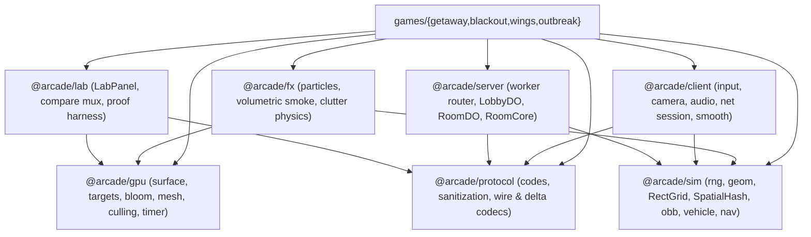
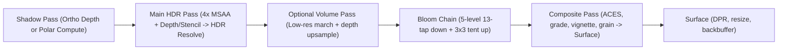

# Arcade Shared Architecture Plan

**Problem:** `anomalyco/arcade` has grown to three live multiplayer games (`getaway`, `blackout`, `wings`) and six active feature branches by copying and adapting whole subsystems between folders. `packages/kit/` shares 332 lines of debug/comparison UI on `main`, while **~5,400 lines of identical or near-identical engine code** — WebGPU post-processing, vertex packing, spatial chunking, keyboard/mouse muxing, camera math, Web Audio graphs, Durable Object matchmaking/lobbies/rooms, OBB rigid-body physics, vehicle simulation, and Playwright proof harnesses — remain duplicated and drifting across games.

**Stakes:** Bugs fixed in one game stay broken in the others (Getaway and Wings still lack Blackout's `BUILD` version handshake and persistent `Lobby` storage; Getaway still uses 48-byte vertices where Blackout uses 24-byte packed vertices; three branches are currently editing `packages/kit/lab-panel.ts` with conflicting types). Adding a fourth game — a co-op survival game in the vein of *Project Zomboid* — by cloning `games/blackout` again would triple the maintenance surface.

**Decision:** Convert the repo into a **Bun workspace monorepo** with **seven focused, versionless TypeScript source packages** (`@arcade/sim`, `@arcade/protocol`, `@arcade/server`, `@arcade/client`, `@arcade/gpu`, `@arcade/fx`, `@arcade/lab`) and one root `bun.lock`. Every package exports raw `.ts` source with zero intermediate build step, is bundled per-game by Vite and Wrangler, and is backed by its own unit tests. Game rules, maps, art, and look stay inside `games/<name>/`.

---

## 1. Honest Assessment of Current Shared Code and Duplication

### 1.1 Quality and seams of `packages/kit/` today

On `origin/main`, `packages/kit/` contains five files totaling **332 lines**:

| File | Lines | Assessment |
| --- | ---: | --- |
| `packages/kit/lab-panel.ts` | 74 | Good UI isolation (Shadow DOM, stops pointer/keyboard propagation, calls `release()` on pointer down). Too narrow: only supports boolean checkboxes on `main`. `getaway-next` (104 lines) and `blackout-look` (82 lines) have already forked it to add `group` headings and `select` dropdowns, and neither includes the rolling FPS/p50/p95/GPU telemetry formatting that both games duplicate in `src/ui/debug-overlay.ts`. |
| `packages/kit/gpu-perf.ts` | 99 | Clever zero-edit `GPUDevice` monkey-patch for historical comparisons, but **mathematically wrong on Apple tile GPUs** when passes overlap: lines 85–87 sum `(times[i + 1] - times[i])` across every pass (`docs/game-notes.md:21-23`). `fx-kit` had to introduce `packages/kit/fx/frame-timer.ts` (32 lines) to measure the true start-to-finish frame envelope. |
| `packages/kit/perf-overlay.ts` | 32 | Legacy readout kept only for historical baseline commits that predate `LabPanel`. |
| `packages/kit/compare.ts` + `.css` | 127 | Solid fixed-tick acknowledgement protocol (`mux-step` → `mux-state` → `mux-sync` → `mux-done`), input ownership handoff, and split/wipe UI. Leaky seam: lines 3–6 and 26 hardcode `game === "blackout"` vs. `"getaway"` (`authority`, `seed`, `stateKeys`) instead of reading those from the child frame's `mux-ready` message. |

In the `fx-kit` worktree, `packages/kit/fx/` adds **620 lines** across eight files (`particles.ts`, `particle-renderer.ts`, `volume.ts`, `volume-renderer.ts`, `volume-shader.ts`, `smoke-trail.ts`, `tyre-renderer.ts`, `frame-timer.ts`) plus `packages/kit/playground/`.
- **What is strong in `fx-kit`:** The simulation modules (`Particles`, `Emitter`, `SmokeVolumes`, `SmokeTrail`) are deep modules: fixed typed-array pools allocated once at construction, zero per-frame object allocations, conservative thin-wall rasterization, and four-connected BFS flood-fill around doors (`volume.ts:43-60`).
- **Where the seam leaks in `fx-kit`:** `ParticleRenderer` (`particle-renderer.ts:47`) and `VolumeRenderer` (`volume-renderer.ts:8, 89-94`) expose raw `Float32Array` uniform buffers that callers must populate by magic float indices (`uniforms[19] = debug`, `uniforms[22] = lightCount`, `uniforms.set(lights, 60)` — documented as a table in `packages/kit/fx/README.md:39-46` and hand-packed in `games/blackout/src/render/renderer.ts` and `playground/stage.ts:107-112`). That is a shallow interface over a deep implementation.

### 1.2 Packaging, imports, tests, and CI gaps

1. **Relative-path imports with no package boundaries:** Games import `../../../../packages/kit/lab-panel` (`games/blackout/src/ui/debug-overlay.ts:1`) and `../../../packages/kit/gpu-perf` (`games/getaway/src/main.ts:18`). Because `packages/kit` has no `package.json` or `tsconfig.json`, files in `packages/kit/` are only typechecked if a game happens to include them (`fx-kit` had to manually patch `"../../packages/kit/fx"` into `games/getaway/tsconfig.json:17`).
2. **Root scripts reach into game `node_modules`:** Because there is no root `package.json` or workspace, root scripts import dependencies out of whichever game folder has them installed:
   - `compare-video/scripts/compare-video.ts:93`: `await import("../games/getaway/node_modules/playwright-core")`
   - `compare-video/scripts/compare-video/getaway.ts:1`: `import ts from "../../games/getaway/node_modules/typescript"`
   - `perf-proposals/scripts/perf/compression.ts:1`: `import { Miniflare } from "../../games/blackout/node_modules/miniflare"`
   - As `docs/game-notes.md:134-136` notes, this pattern already broke Blackout's deploy when a Blackout script imported a Getaway helper that needed Getaway's Playwright install.
3. **Zero standalone tests for `packages/`:** `packages/kit/` has no test runner setup. In `fx-kit`, the unit tests for `packages/kit/fx/` had to be placed inside `games/getaway/tests/fx-kit.test.ts`. Meanwhile, identical unit test suites are duplicated across games (`games/getaway/tests/matchmaking.test.ts` vs. `games/blackout/tests/matchmaking.test.ts`; `games/getaway/tests/idle.test.ts` vs. `games/blackout/tests/idle.test.ts`).
4. **Silent CI blind spots in `.github/workflows/`:**
   - `getaway.yml` and `blackout.yml` trigger on `games/<name>/**` and `packages/kit/**`, but **not** on `scripts/**` — even though `games/blackout/tsconfig.scripts.json:15` typechecks `../../scripts/bench-multiplayer.ts` and both games' `scripts/compare.ts` import `../../../scripts/encode.ts`.
   - `wings.yml` does not trigger on `packages/**` at all.
5. **Toolchain version drift across five lockfiles:** `getaway` and `blackout` use `vite@^8.3.4`, `wrangler@^4.149.0`, and `@cloudflare/workers-types@^5.20261011.1`, whereas `wings` (`games/wings/package.json:18-24`) is stuck on `vite@^7.3.1`, `wrangler@^4.98.0`, and `@cloudflare/workers-types@^4.20260517.0`.

### 1.3 Subsystem duplication matrix

| Subsystem | Getaway | Blackout | Wings / In-flight | Verdict |
| --- | --- | --- | --- | --- |
| **Worker router & DO wiring** | `server/index.ts` (29L), `server/env.ts` (11L) | `server/index.ts` (27L), `server/env.ts` (11L) | `server.ts:1-116` | **98% identical** between Getaway and Blackout. |
| **Matchmaker & Lobby DO** | `server/matchmaking.ts` (86L), `server/lobby.ts` (24L, memory-only) | `server/matchmaking.ts` (89L), `server/lobby.ts` (36L, `ctx.storage` persisted) | `server.ts:308-344` (`RoomDirectory` DO) | **95% identical.** Blackout's storage persistence and `open` predicate should be shared. |
| **Room DO shell & `RoomCore`** | `server/room.ts` (102L), `server/core.ts` (269L) | `server/room.ts` (293L) | `server.ts:124-301`, `src/sim/room-engine.ts` | **~75% duplicated plumbing:** WebSocket pair, `private` storage flag, `MAX_CATCHUP = 4` loop, throttled lobby reports, 15s reconnect grace, input queue, idle kick countdown, `BUILD` handshake (missing in Getaway/Wings). |
| **Client `NetSession` & smoothing** | `src/game/net.ts` (195L), `src/game/netcode.ts` (344L), `src/game/interp.ts` (21L) | `src/game/net.ts` (147L), `src/game/smooth.ts` (51L) | `src/net.ts` (140L) | Socket lifecycle, backoff, RTT ping, seat resume, and sub-tick error decay (`Smoothed` / `ease`) are duplicated. Vehicle proxy collision prediction stays in Getaway. |
| **Seeded RNG & hashing** | `shared/sim/rng.ts` (16L), `shared/protocol.ts:146-150` (`seedOf`) | `shared/rng.ts` (42L: `Rng`, `seedOf`, `hash2`) | inline LCGs in `fx-kit` and `perf-proposals` | **100% duplicate.** Keep one module with both `Rng` class and `mulberry32` function. |
| **2D geometry & spatial grids** | `shared/sim/gadgets.ts` (ray/segment helpers) | `shared/geom.ts` (255L: `RectGrid`, DDA `raycast`, `clearLine`, `pushOut`), `lighting.ts:99-140`, `level-mesh.ts:49-72` | `getaway-clutter` `props/physics.ts:11-35` (`SpatialHash`) | **Four separate spatial grids/hashes** in the repo. Consolidate `RectGrid` (static rects) and `SpatialHash` (dynamic bodies) in `@arcade/sim/geom`. |
| **2D OBB rigid-body solver** | `shared/sim/collide.ts` (337L) | `shared/sim/vehicle-collide.ts` (293L, comment: *"ported from getaway's collide.ts"*) | — | **95% identical** (SAT 2-point clipped manifold + 6-iteration Box2D 2×2 block solver), differing only in `(x, z)` vs. `(x, y)` field names and `sin/cos` heading convention. |
| **Arcade vehicle physics** | `shared/sim/vehicle.ts` (411L) | `shared/sim/vehicle.ts` (353L, comment: *"ported from getaway's vehicle.ts"*) | — | Core bicycle-model integration, drift, and substepped wall/car collision loop are the same algorithm. |
| **Grid nav & binary heap** | `shared/sim/city.ts` (road graph A*) | `shared/sim/nav.ts` (312L: `Nav`, `Heap`, A*, `distances`), `level-mesh.ts:646-683` (second binary heap) | `fx-kit` `volume.ts:50-60` (BFS flood) | Share `MinHeap`, `NavGrid`, A*, and multi-source Dijkstra/BFS flow fields in `@arcade/sim/nav`. |
| **WebGPU targets, bloom & post** | `src/render/renderer.ts` (602L), `src/render/shaders.ts:454-524` | `src/render/renderer.ts` (517L), `src/render/shaders.ts:702-800` | `fx-kit` `playground/stage.ts` (133L) | **Three copies** of MSAA+HDR+depth resize management, 5-level bloom pyramid, `clean()` + `aces()` post composite, and instance/sprite buffer batching. |
| **Mesh builder & vertex packing** | `src/render/mesh.ts` (121L, 48B/vert), `city/big-mesh.ts` | `src/render/mesh.ts` (206L, 24B/vert packed with `snorm8x4`, `unorm8x4`, `float16x2`) | — | Share Blackout's 24-byte packed vertex builder + Getaway's decal UV support in `@arcade/gpu/mesh`. |
| **Static mesh chunking & culling** | `src/render/city-mesh.ts:30-110`, `renderer.ts:22-91, 464-533` | `src/render/level-mesh.ts:765-797`, `renderer.ts:21-36, 447-463` | — | Share frustum plane extraction, AABB culling, contiguous draw-range merging, and cutaway-chunk splitting in `@arcade/gpu/cull`. |
| **Keyboard, mouse & mux input** | `src/game/input.ts` (134L) | `src/game/input.ts` (183L) | `wings/src/input.ts` | **90% identical** key tracking (`e.code` + press-time `chars` map + `Meta` release + `blur` + `mux-*` postMessage protocol). |
| **Camera & trauma/springs** | `src/game/camera.ts` (92L) | `src/render/camera.ts` (158L) | `wings/src/render/camera.ts` | Both top-down games use fixed-yaw/north-up perspective, exponential follow, trauma-squared shake, 240 Hz recoil/landing springs, and `project`/`unproject`. |
| **Web Audio core & spatializer** | `src/audio/audio.ts` (330L) | `src/audio/sound.ts` (354L) | `wings/src/audio/core.ts` | All three build gesture unlock, `M` mute in `localStorage`, compressor, synthetic convolver reverb, and distance lowpass + panner + wet send. |
| **Dev scripts & compare harnesses** | `scripts/dev.ts` (21L), `scripts/compare.ts` (400L) | `scripts/dev.ts` (22L), `scripts/build-id.ts` (23L), `scripts/compare.ts` (880L) | `compare-video/scripts/compare-video.ts` (303L) | Consolidate into shared `@arcade/lab` CLI scripts with a standard in-page harness contract. |

---

## 2. Target Architecture

### 2.1 Package dependency graph and seam rules

Every shared package lives under `packages/<name>` as `@arcade/<name>`. Dependencies flow strictly downward; cycles and cross-game imports (`games/blackout` importing from `games/getaway`) are forbidden.



**Seam rules (enforced by each package's `tsconfig.json`):**
1. **`@arcade/sim` and `@arcade/protocol` are runtime-pure:** `"lib": ["ESNext"]`, `"types": []`. They never reference `window`, `document`, `navigator`, `WebSocket`, `DurableObject`, or `GPUDevice`. They run identically in Cloudflare Workers, browser prediction, and `bun test`.
2. **`@arcade/server` is Worker-only:** `"types": ["@cloudflare/workers-types"]`. It may import `@arcade/sim` and `@arcade/protocol`, never DOM or WebGPU modules.
3. **`@arcade/gpu`, `@arcade/fx`, `@arcade/client`, and `@arcade/lab` are browser/client modules:** They never import `@arcade/server`.
4. **What must stay in `games/<name>/`:**
   - Game rules, round state machines, scoring, modes, and bot brains (`shared/sim/world.ts`, `modes*.ts`, `bots.ts`).
   - Procedural map and city generators (`shared/maps/*`, `shared/sim/city.ts`).
   - Game-specific procedural models, character rigs, and material palettes (`src/render/person.ts`, `car-mesh.ts`, `models.ts`, `street-models.ts`).
   - Game-specific HUDs, menus, and sound synthesis patches (`src/ui/hud.ts`, `src/audio/game-audio.ts`, `sound.ts`).

### 2.2 Package responsibilities and call-site sketches

#### 1. `@arcade/sim` (`packages/sim/`)
Deterministic simulation primitives used by Getaway, Blackout, and Outbreak (the Zomboid survival game).
- **Exports:** `Rng`, `mulberry32`, `seedOf`, `hash2`, `angleDiff`, `RectGrid`, `SpatialHash`, `rayRect`, `raycast`, `clearLine`, `pushOut`, `collideShapes`, `resolve`, `separate`, `stepArcadeCar`, `driveStep`, `NavGrid`, `MinHeap`, `flowField`.
- **Coordinate convention:** All 2D ground-plane functions operate on `{ x, z }` (with heading `h` where `0` faces `+x` and `π/2` faces `+z`; Getaway's `sin/cos` convention is supported via a 1-line heading offset or standardizing during Step 5).

```ts
import { Rng, RectGrid, clearLine, driveStep, NavGrid } from "@arcade/sim"

const rng = new Rng(seedOf(roomCode))
const walls = new RectGrid(map.walls.map((w) => w.rect))

// Fast DDA raycast over the CSR uniform grid (zero per-call allocation)
const visible = clearLine(viewer.x, viewer.z, target.x, target.z, walls)

// Substepped bicycle-model vehicle physics + Box2D 2-point block OBB solver
const impact = driveStep(carBody, controls, vehicleSpec, dt, walls)

// Multi-source Dijkstra flow field for 300 zombies (< 0.15 ms per 128x128 grid update)
const nav = new NavGrid(map.size, solidRects, 1.0)
nav.updateFlowField(livingPlayersAndNoises)
const dir = nav.sampleFlow(zombie.x, zombie.z)
```

#### 2. `@arcade/protocol` (`packages/protocol/`)
Wire validation, room codes, build-hash handshake, and snapshot delta/binary codecs.
- **Exports:** `randomCode`, `normalizeRoom`, `cleanName`, `cleanChat`, `encodeQuantized`, `delta`, `apply`, `BinaryCodec`.

```ts
import { cleanName, encodeQuantized, delta, apply } from "@arcade/protocol"

// Server: round non-exact floats to 3 decimals, preserving exact player reconciliation fields
const wire = encodeQuantized(serverMsg, { exact: [serverMsg.you], exactKeys: ["phaseT"] })

// Co-op survival: per-recipient delta patch against last acked baseline tick
const patch = isKeyframe ? [tick, -1, [0, snap]] : [tick, baseTick, delta(prevSnap, snap)]
```

#### 3. `@arcade/server` (`packages/server/`)
Cloudflare Worker routing, persistent `LobbyDO` matchmaker, and transport-agnostic `RoomCore` + `RoomDO`.
- **Replaces:** `games/{getaway,blackout}/server/{index,env,lobby,matchmaking,room,core}.ts`.

```ts
// games/blackout/server/index.ts — complete Worker entry (~25 lines instead of ~450 across 5 files)
import { createArcadeWorker, createLobbyDO, createRoomDO } from "@arcade/server"
import { BUILD } from "../shared/build.gen"
import { MAX_PLAYERS, SNAPSHOT_HZ, TICK_HZ } from "../shared/config"
import { decodeClient } from "../shared/protocol"
import { blackoutAdapter } from "./adapter"

export const Lobby = createLobbyDO({
  maxPlayers: MAX_PLAYERS,
  staleMs: 30_000,
  // Blackout quick-join fills any non-full room; Getaway passes (r) => !r.private
  isOpen: (r) => r.players > 0 && r.players < MAX_PLAYERS,
})

export const Room = createRoomDO({
  buildId: BUILD,
  tickHz: TICK_HZ,
  snapshotHz: SNAPSHOT_HZ,
  graceMs: 15_000,
  idleKickMs: 90_000,
  idleWarnMs: 15_000,
  decodeClient,
  adapter: blackoutAdapter,
})

export default createArcadeWorker({ prefix: "/arcade/blackout" })
```

#### 4. `@arcade/client` (`packages/client/`)
Browser input, camera, audio graph, `Session` contract, network connection, and prediction/interpolation primitives.
- **Replaces:** `input.ts`, `camera.ts`, `audio.ts` / `sound.ts` bus setup, `net.ts`, and `smooth.ts` across Getaway and Blackout.
- **Where the prediction seam sits:** Both games share `Session<TView, TInput, TEvent>`, `NetConnection` (WebSocket lifecycle, exponential backoff, `sessionStorage` seat resume, `BUILD` version-reload handoff, RTT ping), `SmoothedPose` (sub-tick `prev -> curr` blending plus exponential reconciliation error decay with a teleport snap threshold), and `SnapshotBuffer<TView>` (ring buffer + `est - INTERP_TICKS` bracketed lerp). Game-specific reconciliation rules — such as Getaway's extrapolated proxy car collisions (`games/getaway/src/game/netcode.ts:145-243`) and Blackout's weapon/kit prediction (`games/blackout/src/game/game.ts:208-235`) — stay in their respective games.

```ts
import {
  InputController, TopDownCamera, AudioCore,
  NetConnection, SmoothedPose, SnapshotBuffer,
} from "@arcade/client"

const input = new InputController(canvas) // QWERTY+Dvorak, press-char release, Meta/blur release, compare mux
const cam = new TopDownCamera({ pitch: 1.1, fov: 0.52, dist: 24 })
const audio = new AudioCore({ storageKey: "blackout.mute", reverbSeconds: 1.3 })
const smooth = new SmoothedPose({ rate: 10, snapDist: 6 })
const snaps = new SnapshotBuffer<WorldView>({ tickHz: 30, interpTicks: 3, lerp: lerpView })

// Spatial voice with optional wall-crossing occlusion count (rolls off top end + boosts wet reverb)
const dest = audio.spatial({ dx, dz, gain: 0.85, wet: 0.22, occluders: wallHits })
```

#### 5. `@arcade/fx` (`packages/fx/`)
Shared particle pools, rate/distance emitters, flood-fill volumetric smoke, tyre smoke trails, and decorative client clutter physics (promoted from `fx-kit` and `getaway-clutter`, with typed uniform methods replacing magic float indices).

```ts
import { Particles, Emitter, ParticleRenderer, SmokeVolumes, VolumeRenderer } from "@arcade/fx"

const particles = new Particles()
const smoke = new SmokeVolumes()
const particlePass = new ParticleRenderer(gpu)
const volumePass = new VolumeRenderer(gpu)

// Typed frame update — no raw float offset tables
particlePass.setFrame({ viewProj: cam.viewProj, eye: cam.eye, ambient: [0.08, 0.1, 0.16], lights: nearLights, debug })
volumePass.setFrame({ invViewProj: cam.invViewProj, eye: cam.eye, ambient: [0.08, 0.1, 0.16], lights: nearLights, debug })
```

#### 6. `@arcade/lab` (`packages/lab/`)
Unified `LabPanel` (with built-in rolling FPS/p50/p95/GPU telemetry, `group` headers, `toggle`, `select`, `slider`, `Copy` JSON, and `All On`/`All Off`), data-driven `compare.ts`, and the standard in-page `__arcadeHarness` for Playwright proofs and `compare-video`.

```ts
import { LabPanel } from "@arcade/lab"

const lab = new LabPanel({
  settings: juice,
  params: new URLSearchParams(location.search),
  onRelease: () => input.release(),
  controls: [
    { group: "Lighting", key: "monitors", label: "Monitor Lights" },
    { group: "Lighting", key: "chairs", label: "Chair Shadows" },
    { group: "Smoke", key: "smokeStyle", label: "Smoke Volume", type: "select", options: [
      { value: 0, label: "Off" },
      { value: 1, label: "Volumetric" },
    ]},
  ],
})

// Inside the frame loop — updates rolling p50/p95/FPS and posts "arcade-perf" when in compare iframe:
lab.recordFrame(now, elapsedMs, gpu.telemetry, { chunks: renderer.drawnChunks, lights: culler.lightCount })
```

### 2.3 Consumption Model: Bun Workspace vs. Relative Imports

| Criterion | Relative Imports (Current) | Bun Workspace with Source Packages (Target) |
| --- | --- | --- |
| **Import syntax** | `import { LabPanel } from "../../../../packages/kit/lab-panel"` | `import { LabPanel } from "@arcade/lab"` |
| **Build step for packages** | None | **None** (`"exports": { ".": "./src/index.ts" }` points straight to `.ts`) |
| **Lockfiles** | 5 separate `bun.lock` files; versions drift (`wings` on Vite 7 / Wrangler 4.98) | **1 root `bun.lock`**; single version of Vite, Wrangler, TypeScript, Playwright |
| **Root scripts (`scripts/*`)** | Hacky `await import("../games/getaway/node_modules/...")` | Normal `import { chromium } from "playwright-core"` from root `package.json` |
| **Package unit tests** | Impossible in `packages/kit`; tests stuffed into `games/getaway/tests/` | `bun test packages/` runs all shared unit tests in < 300 ms |
| **Cloudflare Worker deploy** | `cd games/blackout && bun run deploy` | **Unchanged:** `cd games/blackout && bun run deploy` (Wrangler's esbuild follows workspace symlinks and bundles `@arcade/*` `.ts` source into the Worker) |
| **CI speed & caching** | `bun install --frozen-lockfile` per game | `bun install --frozen-lockfile` at repo root (< 2 s with `setup-bun` cache) |

**CI Workflow Trigger Rule:**
- Add `.github/workflows/packages.yml` triggered on `packages/**`, `scripts/**`, and `bun.lock` to run `bun run check:packages` (typecheck + `bun test packages/`).
- Update `getaway.yml`, `blackout.yml`, and `wings.yml` `paths` to include `packages/**`, `scripts/**`, and `bun.lock` so any shared code or build-script change is verified against every consuming game before merge and deploys affected Workers on `main`.

---

## 3. Low-Level WebGPU Layer (`@arcade/gpu`) and Lessons from `vgpu`

### 3.1 Study of `vgpu` (`https://vgpu.sh/`): What to Borrow and What to Skip

`vgpu` separates a high-level shader/effect facade (`vgpu`) from an explicit low-level wrapper (`vgpu/core`), a build-time WGSL module resolver (`@vgpu/wgsl`), and deterministic headless/browser testing conventions. We do **not** want to depend on `vgpu`, but studying its design clarifies which abstractions pay for themselves in our games and which would add framework weight.

| `vgpu` Idea | Borrow or Skip? | Why for Arcade |
| --- | --- | --- |
| **`Surface` + `Target` owning MSAA, depth, cached views, and `onResize` (`vgpu/surface`, `vgpu/target`)** | **Borrow** | Both Getaway (`renderer.ts:340-389`) and Blackout (`renderer.ts:304-349`) duplicate ~90 lines of manual texture destruction, MSAA/depth/HDR/bloom recreation, cached `GPUTextureView` wiring, and DPR clamping on resize. A `Surface` + `Target` abstraction that owns its views and fires `onResize` subscribers deletes that boilerplate cleanly. |
| **Explicit `bind.*` and sampler sugar (`vgpu/core/bind`)** | **Borrow** | `bind.uniform(0, "vertex|fragment")`, `bind.readonlyStorage(1, "fragment")`, `bind.texture(2, "fragment")`, and `createSampler(device, { filter: "linear", wrap: "clamp" })` cut 30-line verbose WebGPU descriptors down to 6 readable lines with zero runtime reflection overhead. |
| **Pure WGSL module rule (`@vgpu/wgsl`)** | **Borrow (via TS functions)** | In `vgpu`, imported WGSL modules must be pure (functions and structs only; `@group`/`@binding` live only in entry shaders). We get the exact same benefit without bundler plugins by exporting pure WGSL snippets (`acesWgsl`, `cleanHdrWgsl`, `bloomShaderWgsl`, `bayerCutawayWgsl`) as TypeScript functions/constants composed by each game's entry shader. |
| **Schema-aligned uniform & instance writers (`StructuredUniform`, `geometry()`)** | **Borrow (simplified)** | Replaces `fx-kit`'s fragile magic float indices (`uniforms[19]`, `uniforms.set(lights, 60)`) and repeated `ensureInstances` buffer-growing code with a typed `UniformBuffer` and `InstanceStream`. |
| **Non-blocking pass `Timer` + whole-frame envelope (`vgpu/timer` + `FrameTimer`)** | **Borrow** | Combines `vgpu`'s rotated staging-buffer readback and named pass spans (`polar`, `shadow`, `main`, `bloom`) with `fx-kit`'s dependent-pass `FrameTimer` so overlapping passes on Apple GPUs never inflate total GPU ms. |
| **Deterministic single-frame render & `target.color.read()` (`guides/browser-testing`)** | **Borrow** | Standardizes headless proof captures (`dpr: 1`, `autoResize: false`, explicit `step()` + `readPixels()`) without relying on `requestAnimationFrame` or AST-rewriting minified production bundles (`compare-video/getaway.ts:49-115`). |
| **Agent-oriented diagnostics (`vgpu doctor`, `vgpu check`, structured `VGPUError` with `fix`/`where`)** | **Borrow (as repo scripts)** | `compileShader` surfaces line-accurate WGSL compilation errors with labels, and a lightweight `bun scripts/gpu-doctor.ts` verifies Chromium + Apple Metal (`!isFallbackAdapter`, `timestamp-query`) with a JSON verdict before any benchmark or capture run. |
| **External docs/examples CLI & MCP server (`vgpu docs`, `vgpu examples`, `vgpu mcp`)** | **Skip** | `vgpu` ships a CLI/MCP server because it is a public npm library consumed by external repos. For our monorepo, in-repo `docs/` and `@arcade/*` TypeScript types are already in the agent's workspace. |
| **Runtime WGSL parser/reflection & auto-bind-group caching (`draw.set({ ... })`)** | **Skip** | Our games have a fixed set of 5–8 pipelines per renderer and upload one contiguous `Float32Array` per frame. Runtime WGSL parsing and per-property `set()` maps add complexity with zero leverage. |
| **Dawn native C++ Node prebuilds (`@vgpu/adapter-node`) & Swift/Metal codegen (`@vgpu/native`)** | **Skip** | Our target is browser WebGPU on Metal (`--use-angle=metal` in headless Chromium via `hivemind`). Testing in Chromium tests the exact browser WebGPU stack players run. |
| **CPU half-edge mesh editing (`@vgpu/render/edit`) & scene graph (`vgpu/scene`)** | **Skip** | Games build static level chunks once per seed and submit flat `InstanceBatch[]` arrays. |

### 3.2 `@arcade/gpu` Architecture and Module Design

`@arcade/gpu` (`packages/gpu/src/`) is ~450 lines of TypeScript across six focused files:



1. **`context.ts` — Device, `Surface`, `Target`, and Backpressure Scheduler**
   - `initGpu(canvas, { maxDpr, depthFormat, msaa })`: Requests high-performance adapter, enables `"timestamp-query"` when supported, attaches `uncapturederror` logging, configures the canvas, and returns `{ device, surface, telemetry }`.
   - `surface.onResize(({ width, height, dpr }) => ...)`: Fires immediately and on window resize.
   - `createTarget(device, { size, format, samples, depth })`: Owns `msaaTexture`, `resolveTexture`, `depthTexture`, and their cached `GPUTextureView`s (`target.view`, `target.msaaView`, `target.depthView`, `target.depthOnlyView` for `VolumeRenderer`), plus `target.resize(w, h)` and `target.beginPass(encoder, opts)`.
   - Includes Blackout's 2-frames-in-flight `FrameScheduler` (`blackout/src/render/renderer.ts:351-380`) so software/slow adapters drop intermediate frames instead of building an unbounded queue.
2. **`bind.ts` — Explicit Layout, Pipeline, and Sampler Helpers**
   - `bind.uniform(binding, vis)`, `bind.storage(binding, vis, readOnly)`, `bind.texture(binding, vis, sampleType)`, `bind.sampler(binding, vis, type)`.
   - `compileShader(device, label, code)`: Compiles WGSL and logs line-accurate `getCompilationInfo()` errors (`blackout/src/render/renderer.ts:234-239`).
3. **`buffers.ts` — `InstanceBuffer` and `SpriteBuffer`**
   - `InstanceBuffer(device, strideFloats, initialCap)`: Packs `InstanceBatch[]` into one GPU vertex buffer, growing by 1.5× when needed and coalescing contiguous `Float32Array` slices into a single `queue.writeBuffer` call (`blackout/src/render/renderer.ts:398-424`).
   - `SpriteBuffer(device, maxSprites, strideFloats)`: Manages the split `alpha` / `add` sprite buffer used by both games.
4. **`post.ts` — Shared HDR Bloom Pyramid and Tone-Mapped Composite (`BloomChain`)**
   - Encapsulates the 5-level `rgba16float` bloom pyramid (`down` 13-tap Jimenez filter with soft-knee threshold + `clean()` NaN/Inf guard, `up` 3×3 additive tent filter) and the final fullscreen composite pass.
   - Games can supply their own grading snippet (Getaway's navy-shadow/warm-highlight grade vs. Blackout's chromatic aberration + film grain) or use the default ACES + vignette + flash composite.
5. **`mesh.ts` & `cull.ts` — 24-Byte Packed `Mesh`, Spatial Chunking, and Frustum/Cutaway Culling**
   - Promotes Blackout's 24-byte `Mesh` + `packVerts` (`float32x3` pos, `snorm8x4` normal, `unorm8x4` color, `float16x2` mat/aux — cutting Getaway's city vertex buffer size in half from 48 bytes to 24 bytes; UV decals use an optional `float16x2` attribute or material aux).
   - `partitionMesh(mesh, cellSize)`: Spatial AABB chunker with `cutBox` bounds (for switching between early-Z-friendly `fsSolid` and `fsCut` only on chunks intersecting the camera-to-player cutaway cone) and adjacent draw-range merging (`getaway/src/render/renderer.ts:474-484`).
   - `extractFrustumPlanes(viewProj, out)` and `aabbInFrustum(planes, chunk)`.
6. **`telemetry.ts` — `GpuTelemetry` and `readPixels`**
   - Unifies `GpuPerf` and `FrameTimer`: tracks `draws` and `verts` per frame, measures the true whole-frame GPU interval from first pass start to final composite end (no overlapping pass sum), and optionally records named pass spans (`polar`, `shadow`, `main`, `smoke`, `post`) via ring-buffered query sets.
   - `readPixels(device, target)`: Copies a target or canvas texture to a staging buffer, strips row padding, swizzles `bgra8unorm` to RGBA, and returns `Uint8Array` for headless assertions.

### 3.3 Call-Site Sketches: `@arcade/gpu` in Action

**1. Mesh building, 24-byte vertex packing, and spatial chunking:**
```ts
import { Mesh, partitionMesh } from "@arcade/gpu"

const mesh = new Mesh()
mesh.bevelBox(x0, 0, z0, x1, 2.8, z1, 0.035, wallSideRgb, wallTopRgb, MAT.wall, MAT.cap)
mesh.prism(lamp.x, lamp.z, 0.34, 0.1, 2.38, 2.6, 10, fixtureRgb, MAT.shiny)

// Packs to 24B/vertex (f32x3 pos, snorm8x4 normal, unorm8x4 color, f16x2 mat/aux)
// and partitions into 16m AABB chunks with separate cutBox bounds for cutaway walls.
const level = partitionMesh(device, mesh, { cellSize: 16, cutMaterials: [MAT.wall, MAT.cap, MAT.lamp] })
```

**2. Device, surface, targets, explicit bind groups, and frame pass list:**
```ts
import {
  initGpu, createTarget, BloomChain, UniformWriter, InstanceBuffer, SpriteBuffer,
  bind, createBindGroupLayout, createBindGroup, createSampler, compileShader,
  VERTEX_24B_LAYOUT, INSTANCE_48B_LAYOUT, extractFrustumPlanes,
} from "@arcade/gpu"

const { device, surface, telemetry } = await initGpu(canvas, { maxDpr: 2 })
const sceneTarget = createTarget(device, {
  size: surface.size,
  format: "rgba16float",
  samples: 4,
  depth: "depth24plus-stencil8",
})
const bloom = new BloomChain(device, surface.format, { gradeWgsl: getawayGradeWgsl })
const frameUniforms = new UniformWriter(device, {
  viewProj: "mat4x4f",
  lightViewProj: "mat4x4f",
  cam: "vec4f",
  focus: "vec4f",
  screen: "vec4f",
})
const instances = new InstanceBuffer(device, 12, 512)
const sprites = new SpriteBuffer(device, 6000, 12)

const mainLayout = createBindGroupLayout(device, [
  bind.uniform(0, "vertex|fragment"),
  bind.storage(1, "vertex|fragment", true),
  bind.depthTexture(2, "fragment"),
  bind.comparisonSampler(3, "fragment"),
])
const mainGroup = createBindGroup(device, mainLayout, [
  frameUniforms.buffer,
  lightStorageBuffer,
  shadowTarget.depthView,
  createSampler(device, { compare: "less", filter: "linear" }),
])
const litMod = compileShader(device, "scene-lit", litShaderWgsl)
const solidPipe = sceneTarget.createPipeline({
  layout: [mainLayout],
  module: litMod,
  vs: "vsStatic",
  fs: "fsSolid", // no discard -> preserves Apple GPU early-Z HSR
  buffers: [VERTEX_24B_LAYOUT],
})
const cutPipe = sceneTarget.createPipeline({
  layout: [mainLayout],
  module: litMod,
  vs: "vsStatic",
  fs: "fsCut", // dithered cutaway only for chunks overlapping the player cone
  buffers: [VERTEX_24B_LAYOUT],
})

surface.onResize(({ width, height }) => {
  sceneTarget.resize(width, height)
  bloom.resize(width, height, sceneTarget.view)
  volumeRenderer.resize(width, height, sceneTarget.depthOnlyView)
})

// Per frame (coalesced to <= 2 frames in flight, single command encoder submit):
surface.frame((encoder, backbufferView) => {
  frameUniforms.write({ viewProj: cam.viewProj, lightViewProj, cam: [...cam.eye, time], focus, screen })
  const ranges = instances.upload(batches)
  const { alphaCount, addOffset, addCount } = sprites.upload(alphaData, alphaN, addData, addN)
  extractFrustumPlanes(cam.viewProj, 0, camPlanes)

  // 1. Shadow pass (ortho depth map or polar 2.5D raycast compute pass)
  encodeShadows(encoder, ranges, telemetry.span("shadow"))

  // 2. Main 4x MSAA HDR pass (resolves into sceneTarget.view)
  const pass = sceneTarget.beginPass(encoder, { clear: [0.02, 0.025, 0.04, 1], timer: telemetry.span("main") })
  pass.setBindGroup(0, mainGroup)
  level.drawCulled(pass, camPlanes, solidPipe, cutPipe, cutawayCone)
  instances.drawRanges(pass, instPipe, models, ranges)
  sprites.draw(pass, spriteAlphaPipe, spriteAddPipe, alphaCount, addOffset, addCount)
  pass.end()

  // 3. Optional post-HDR volumetric smoke (reads MSAA depth, composites into sceneTarget.view)
  volumeRenderer.render(encoder, sceneTarget.view, smokeVolumes, telemetry.span("smoke"))

  // 4. 5-level Jimenez bloom + ACES composite to swapchain backbuffer
  bloom.render(encoder, backbufferView, { strength: 0.9, flash, time }, telemetry.span("post"))
})
```

**3. Headless capture and deterministic stepping for tests and `compare-video`:**
```ts
import { registerHarness } from "@arcade/lab"
import { readPixels } from "@arcade/gpu"

registerHarness({
  game: "getaway",
  surface,
  telemetry,
  lab,
  reset(seed, stage) {
    session = new LocalSession("Dax", { robber: "muscle", cop: "cruiser" }, seed)
    if (stage) applyStage(session.world, stage)
    scene.reset()
    cam.snap(session.focus().x, session.focus().z)
  },
  async step(dt, input, syncState) {
    const view = syncState ? session.sync(syncState) : session.update(dt, input)
    scene.draw(view, cam, surface.width, surface.height, dt)
    await device.queue.onSubmittedWorkDone()
    return { view, camera: cam.snapshot(), gpuMs: telemetry.gpuMs }
  },
  readPixels: () => readPixels(device, surface),
})
```

---

## 4. Testing, Lab Panel, and Proof Conventions

### 4.1 The One Shared Lab Panel Rule

1. **`@arcade/lab`'s `LabPanel` is the sole interactive debug and lookdev UI** across every game (`AGENTS.md:8`).
2. **Never add URL query parameters for visual switches, look presets, or effect toggles.** Every tunable (lights, shadows, AO, smoke style, camera shake, clutter physics, audio occlusion, debug views) is declared as a `LabControl` (`toggle`, `select`, or `slider`) grouped by `group` heading inside `LabPanel`.
3. **Query parameters are strictly for automation and session routing:**
   - Routing: `?room=CODE` (or `?r=CODE`), `?solo`, `?practice`, `?mode=ID`, `?map=KIND`.
   - Automation & harnesses: `?seed=N`, `?peaceful=1`, `?lab=1`, `?perf=1`, `?vanilla=1`, `?mux=1&muxRun=ID`, `?bench=1`, `?nohud=1`.
4. **Built-in telemetry & preset export:** `LabPanel` owns the rolling 180-frame p50/p95/FPS + GPU HW ms header, `All On` / `All Off` buttons, and a `Copy` button that copies current settings as JSON so playtest verdicts can be pasted straight into `docs/game-notes.md`.

### 4.2 Four-Tier Verification Pyramid

1. **Tier 1 — Fast Unit Tests (`bun test packages/ games/`, < 1 s, runs on every PR):**
   - Pure TS tests for `@arcade/sim` (OBB manifolds, vehicle substeps, `RectGrid` DDA vs. linear raycast equivalence, A* and flow-field correctness), `@arcade/protocol` (input sanitization, delta/binary round-trip), `@arcade/server` (`Matchmaker` churn, `RoomCore` seat grace, idle kick, `BUILD` reload handshake), and `@arcade/fx` (wall-sealed smoke flood, bullet carve/refill, emitter teleport rejection).
2. **Tier 2 — Determinism & Multiplayer Wire Proofs (`bun scripts/bench-multiplayer.ts --paired`):**
   - Runs two seeded `World` instances for 1,000 ticks, asserting identical SHA-256 snapshot digests and measuring paired shared-snapshot preparation medians (`1 warmup + 9 measured pairs`).
3. **Tier 3 — Native Metal Render & Lab Proofs (headless Chromium `--use-angle=metal` via `hivemind`):**
   - Every game exposes `window.__arcadeHarness = { ready, adapterInfo, reset(seed, stage), step(dt, input, sync?), setLab(key, value) }` wired through `@arcade/lab`.
   - Scripts verify `adapterInfo.vendor === "apple"` (never SwiftShader), step fixed frames, assert zero console/page/WebGPU validation errors, and measure paired whole-frame GPU timestamps via `FrameTimer` (`1 warmup + >= 7 alternating on/off pairs`).
4. **Tier 4 — Paired Compare Videos & Contact Sheets (`bun scripts/compare-video.ts`):**
   - Uses `@arcade/lab`'s standard `__arcadeHarness` across all games (`--game getaway|blackout|outbreak`) so `compare-video.ts` works out of the box without AST-patching `main.ts`.
   - Encodes side-by-side or stacked MP4s on the `hivemind` fleet with `-c:v h264_videotoolbox -profile:v high -q:v 75` and outputs a 3–4 keyframe contact sheet + JSON manifest.

---

## 5. Shared Foundation for the Co-op Survival Game (`games/outbreak`)

The full vertical slice design lives in [`docs/zomboid-slice.md`](./zomboid-slice.md). Below is how its eight core requirements map onto the shared `@arcade/*` packages versus existing code:

| Survival Requirement | Shared Package (`@arcade/*`) | Existing Code Source | Game-Specific (`games/outbreak/`) |
| --- | --- | --- | --- |
| **1. World (chunked 2.5D tiles & streaming)** | `@arcade/sim/geom` (`RectGrid`), `@arcade/gpu/mesh` (24B `Mesh`, chunker, cutaway split) | `blackout/src/render/level-mesh.ts` (12m chunks, `bakeFloor`, `bakeBounce`) | 32×32m chunk streamer, suburban/town generator, `ChunkDelta` overlay (doors, broken glass, barricades) |
| **2. Visibility (LOS & fog of war)** | `@arcade/gpu` (polar raycast compute + 3-state shroud shader), `@arcade/sim/geom` (`clearLine`) | `blackout/src/render/lighting.ts` + `shaders.ts:61-130` (`polarShader`, 720 rays) | Polar slot 0 bound to player eye + flashlight cone; per-chunk explored bitmask |
| **3. Time & weather (day/night cycle)** | `@arcade/gpu` (directional sun/moon shadow + ambient uniforms), `@arcade/fx` (rain/fog) | `getaway/src/render/shaders.ts:36-60` (ortho shadow), `blackout` wet-asphalt gloss | `DayCycle` clock (sun/moon arc, dusk streetlamp cutover) & `Weather` state machine |
| **4. Zombies (flow-field horde + noise)** | `@arcade/sim/nav` (`NavGrid.updateFlowField`), `@arcade/sim/geom` (`SpatialHash`, `pushOut`) | `blackout/shared/sim/nav.ts:218-241` (`distances` BFS), `blackout` noise ripple table | Zombie SoA pool (Wander / Flow-Horde / Lunge / Pound), noise attractor decay |
| **5. Survival (inventory, crafting, barricades)** | `@arcade/sim/geom` (dynamic solid insertion into `RectGrid`) | `blackout/shared/sim/kit.ts`, `melee.ts`, `vehicle-rules.ts` (4-seat vehicles) | Slot inventory, loot tables, bleeding/infection vitals, plank barricades on windows/doors |
| **6. Persistence (DO SQLite save/load)** | `@arcade/server` (`RoomDO` SQLite checkpoint hooks + `alarm()` hibernation) | `blackout/server/lobby.ts` (DO storage), `wings/server.ts:178-288` (`alarm()` lifecycle) | SQLite tables (`world_meta`, `chunks`, `players`, `vehicles`), `/api/room/:code/snapshot` |
| **7. Netcode (2–8 co-op, interest & deltas)** | `@arcade/protocol` (`delta`, `apply`, `BinaryCodec`), `@arcade/server`, `@arcade/client` | `perf-proposals/scripts/perf/codecs.ts` & `network.ts` (60m radius + delta proof) | 60m chunk/zombie interest filter + per-player inventory/vitals state |
| **8. Feel (audio occlusion & shared FX)** | `@arcade/client/audio` (raycast wall-count lowpass + wet scaling), `@arcade/fx` | `blackout/src/audio/sound.ts:79-97`, `fx-kit` (`SmokeVolumes`, `Particles`), `getaway-clutter` | Zombie groans, window smash, wood splintering, house-fire smoke propagation |

---

## 6. Ordered Migration Plan

Each step is small, independently shippable, and leaves `bun run check` green across every project.

### Step 1: Root Bun Workspace, Unified Lockfile, and CI Triggers
- **Create:** Root `package.json` (`"workspaces": ["packages/*", "games/*", "landing", "redirects"]`), root `tsconfig.base.json`, and `packages/lab/package.json` (wrapping existing `packages/kit/*` with re-exports at `packages/kit/*` during transition).
- **Align:** Upgrade `games/wings/package.json` to match `vite@^8.3.4`, `wrangler@^4.149.0`, and `@cloudflare/workers-types@^5.20261011.1`; generate one root `bun.lock`.
- **Update CI:** Add `.github/workflows/packages.yml` and add `packages/**`, `scripts/**`, and `bun.lock` to path triggers in `getaway.yml`, `blackout.yml`, and `wings.yml`.
- **Deletes:** 4 redundant per-project `bun.lock` files; relative `../../games/*/node_modules/*` imports in `scripts/`.

### Step 2: Unified `@arcade/lab` (`LabPanel`, `compare.ts`, `build-id`, `dev`)
- **Create:** `@arcade/lab` merging `getaway-next` and `blackout-look` `LabPanel` features (`group`, `select`, `slider`, `Copy`, plus built-in rolling p50/p95/FPS/GPU telemetry formatting), data-driven `compare.ts` (reading `authority` and `stateKeys` from `mux-ready`), and shared `build-id` + `dev` CLI helpers.
- **Deletes:**
  - `games/getaway/src/ui/debug-overlay.ts` telemetry math (~30 lines) and `games/blackout/src/ui/debug-overlay.ts` telemetry math (~20 lines), leaving only declarative `LabControl[]` arrays.
  - `games/getaway/scripts/dev.ts` (21 lines) and `games/blackout/scripts/dev.ts` (22 lines).
  - Hardcoded game branches in `packages/kit/compare.ts:3-6, 26`.

### Step 3: `@arcade/sim` and `@arcade/protocol` (RNG, Geometry, OBB Solver, Vehicles, Nav, Codecs)
- **Create:** `packages/sim/` (`rng.ts`, `geom.ts`, `obb.ts`, `vehicle.ts`, `nav.ts`) and `packages/protocol/` (`codes.ts`, `sanitize.ts`, `quantize.ts`, `delta.ts`, `binary.ts`) with comprehensive unit tests in `packages/sim/tests/` and `packages/protocol/tests/`.
- **Deletes:**
  - `games/getaway/shared/sim/rng.ts` (16 lines) and `games/blackout/shared/rng.ts` (42 lines).
  - `games/blackout/shared/sim/vehicle-collide.ts` (293 lines) and `games/getaway/shared/sim/collide.ts` (337 lines) — replaced by `@arcade/sim/obb`.
  - Duplicated spatial grids in `games/blackout/src/render/lighting.ts:99-140`, `games/blackout/src/render/level-mesh.ts:49-72`, and `getaway-clutter`'s `SpatialHash` (30 lines) — replaced by `@arcade/sim/geom`.
  - Inline binary heap in `games/blackout/src/render/level-mesh.ts:646-683` (38 lines) — replaced by `@arcade/sim/nav`'s `MinHeap` / flow field.
  - Duplicated `randomCode`, `cleanName`, `seedOf`, and float-rounding JSON encoders in `games/{getaway,blackout}/shared/protocol.ts` (~70 lines).

### Step 4: `@arcade/server` (Worker Router, Persistent `LobbyDO`, `RoomDO` & `RoomCore`)
- **Create:** `packages/server/` with `Matchmaker`, persistent `LobbyDO`, `RoomCore`, `RoomDO` (including `BUILD` version handshake and SQLite storage hooks), and `createArcadeWorker`, plus unit tests in `packages/server/tests/`.
- **Adopt:** Wire `games/getaway/server/` and `games/blackout/server/` to `@arcade/server`. This automatically gives Getaway persistent lobby storage across DO evictions and the `BUILD` client/server version reload handshake.
- **Deletes:**
  - `games/getaway/server/{index,env,lobby,matchmaking,room}.ts` (~252 lines) and ~160 lines of boilerplate in `games/getaway/server/core.ts`.
  - `games/blackout/server/{index,env,lobby,matchmaking}.ts` (~163 lines) and ~180 lines of boilerplate in `games/blackout/server/room.ts`.
  - Duplicate test files `games/getaway/tests/matchmaking.test.ts` (92 lines) and `games/blackout/tests/matchmaking.test.ts` (125 lines) — moved to `packages/server/tests/matchmaking.test.ts`.

### Step 5: `@arcade/client` (Input, TopDownCamera, AudioCore, NetConnection, SmoothedPose)
- **Create:** `packages/client/` (`input.ts`, `camera.ts`, `audio.ts`, `net.ts`, `smooth.ts`) with unit tests.
- **Deletes:**
  - ~90 lines of keyboard/mux boilerplate in `games/getaway/src/game/input.ts` and ~110 lines in `games/blackout/src/game/input.ts`.
  - `games/blackout/src/game/smooth.ts` (51 lines) and duplicate error-easing math in `games/getaway/src/game/netcode.ts`.
  - ~120 lines of WebSocket reconnect/ping/rejoin boilerplate across `games/{getaway,blackout}/src/game/net.ts`.
  - ~150 lines of Web Audio context unlock, mute persistence, compressor, and convolver impulse generation across `games/getaway/src/audio/audio.ts` and `games/blackout/src/audio/sound.ts`.

### Step 6: `@arcade/gpu` and `@arcade/fx` (WebGPU Layer + Particles/Smoke/Clutter)
- **Create:** `packages/gpu/` (`context.ts`, `bind.ts`, `buffers.ts`, `post.ts`, `mesh.ts`, `cull.ts`, `telemetry.ts`) and `packages/fx/` (migrating `fx-kit`'s `packages/kit/fx/` and `getaway-clutter`'s `PropPhysics` onto `@arcade/gpu` with typed uniform setters).
- **Verify:** Run paired Metal benchmarks and pixel-parity checks (`prove-fx-playwright.ts`, `compare.ts`) to confirm zero visual regression and equal or better GPU frame times.
- **Deletes:**
  - ~280 lines of duplicated MSAA/depth/HDR/bloom setup, instance/sprite buffer packing, and post shaders in `games/getaway/src/render/renderer.ts` + `shaders.ts`.
  - ~260 lines of the same in `games/blackout/src/render/renderer.ts` + `shaders.ts`.
  - `games/getaway/src/render/mesh.ts` (121 lines) and `games/blackout/src/render/mesh.ts` (206 lines) — unified in `@arcade/gpu/mesh`.
  - `games/getaway/src/render/city-mesh.ts:30-110` (`partitionCityMesh`) — moved to `@arcade/gpu/cull`.

### Step 7: Standardize `__arcadeHarness` and `compare-video` Across All Games
- **Update:** Wire `@arcade/lab`'s `registerHarness()` in `getaway` and `blackout` so `bun scripts/compare-video.ts --game getaway|blackout` drives both games through the same clean interface.
- **Deletes:**
  - `compare-video/scripts/compare-video/getaway.ts:6-115` (110 lines of fragile TypeScript AST rewriting of minified bundles).
  - Duplicate capture/stitching boilerplate across `games/getaway/scripts/compare.ts` and `games/blackout/scripts/compare.ts` (~600 lines combined).

### Step 8: Scaffold `games/outbreak` (Co-op Survival Vertical Slice)
- **Create:** `games/outbreak/` consuming `@arcade/sim`, `@arcade/protocol`, `@arcade/server`, `@arcade/client`, `@arcade/gpu`, `@arcade/fx`, and `@arcade/lab`, following [`docs/zomboid-slice.md`](./zomboid-slice.md).
