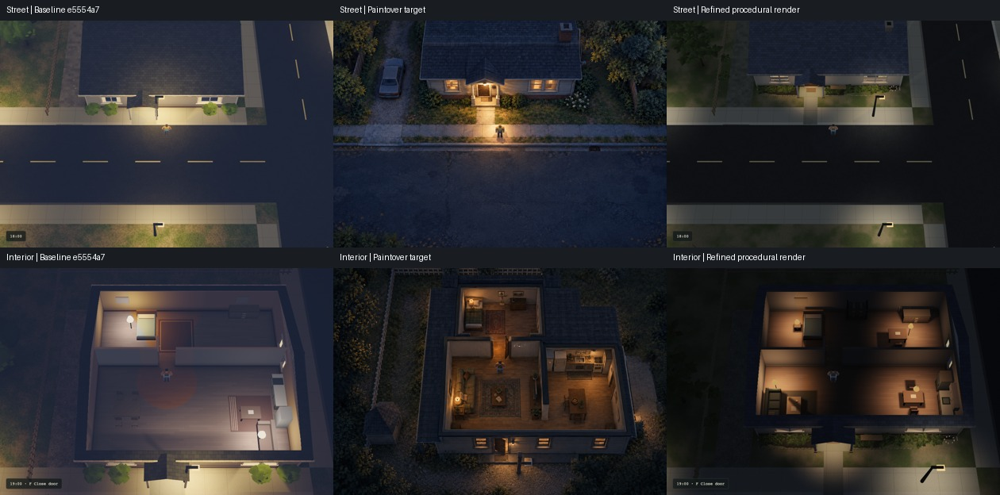

# Outbreak look refinement

The first pass was too pale, flat and empty. This revision reduces broad light spill, gives the houses a
real front setback, and groups furniture around usable circulation. The target still has more natural
foliage, material wear and indirect shadows. This is an improvement for integration review, not a target match.



The columns are baseline `e5554a7`, the existing generated target, and the refined game. Both game captures
use seed 7, 1000 × 680, DPR 1, the full frame, and the same exploration route. Street: player `(30,41)`,
aim `−π/2`, 18:00, camera distance 42. Interior: `(27.7,31)`, aim `−π/2`, 19:00, distance 34, bedroom door open.
The target changed geometry and interior partitions; it is still an art reference rather than an exact plan.
The late-20th-century US housing assumption remains unapproved.

## The washed-out ground was diffuse light and grading

The baseline contribution captures show zero ground specular. Pale diffuse albedo, broad practical pools,
ambient light and the post pass's blue shadow lift explain most of the perceived reflectivity. Bloom contributes
around fixtures but is not the main cause. The shared Lab now exposes Beauty, Albedo, Direct, Ambient + sky,
Specular, Bloom and Before memory. Contribution views bypass exposure/tonemapping and apply display gamma;
they are diagnostic views, not additive display-space layers.

The single Look group controls exposure, sky fill and practical-light power. Outbreak opts into the shared
renderer hooks for sheltered ambient, shadow-respecting light fill, five interpolated shadow taps, and a
restrained hue-preserving shoulder. Bloom is 0.045 and additive shadow lift is zero. The world-anchored shadow
sampling has no frame-varying jitter. Twelve existing shared shader outputs, including Blackout's look/motion
combinations, match `e5554a7` after whitespace normalization.

Room lamps previously lit roof surfaces from below. Outbreak now tags room lights with `cone.w = -1` and skips
their contribution above 2.75 m. Positive `cone.w` keeps its existing beam meaning for small outward window
pools. Window backing, curtain folds, sills and mullions provide depth. Room-memory desaturation is weaker so
warm practical light survives outside the eye cone. Furniture and window bases cast polar shadows; they do
not join the authoritative eye-height sight rectangles.

Shared options live in `packages/kit/gpu/shaders.ts` and `surface-materials.ts`; procedural houses, light
placement, palette and semantics remain in Outbreak. No second rendering path was added.

## The setback and furniture are part of the world

Both house fronts move back 2.5 m, from 15 × 14 m to 15 × 11.5 m footprints. `BUILDING_RECTS` supplies the
map and shader cutaways. The front door, walls, room-memory boundaries, floor mesh, entrance path and support
query use those same footprints. The original bedroom partition remains at its existing coordinate.

The porch has a gabled canopy, posts, casing, threshold and doormat. Its shallow raised walk reaches the
sidewalk. Dark mulch, irregular folded-leaf sprays, gaps and a few flowers replace rows of bright sphere shrubs.
The same deterministic house recipe serves Ash and Elm.

The interior has a sofa/rug/coffee-table group, kitchen counter/sink/stove/fridge, dining chairs, and a bed with
nightstand plus dresser and shelves. Furniture footprints block movement and supply baked contact shading;
the entrance-to-bedroom lane remains clear. Decorative trim, planting and the porch bench remain visual props.
Actor visibility still depends on `Vision.visible`; brighter scenery does not reveal actors through walls.

## Geometry falls by a third; frame cost is mixed

Seven alternating measured pairs after one warmup pair, 120 steps per run, Apple M5 Max / Metal, 1000 × 680,
DPR 1. Baseline is the exact `e5554a7` archive. Raw reports are
[`perf/outbreak-look-v2-street.json`](../perf/outbreak-look-v2-street.json) and
[`perf/outbreak-look-v2-interior.json`](../perf/outbreak-look-v2-interior.json).

| Metric | Baseline | Refined |
| --- | ---: | ---: |
| Static world vertices | 299,238 | 196,722 |
| Street median of run medians | 10.0 ms | 9.6 ms |
| Street range of run medians | 9.0–14.6 ms | 8.8–10.8 ms |
| Interior median of run medians | 9.9 ms | 10.7 ms |
| Interior range of run medians | 9.2–14.8 ms | 8.5–13.2 ms |
| Street sampled bytes / step | 576,880 | 571,228 |
| Interior sampled bytes / step | 523,439 | 542,410 |

Median paired deltas are −1.2 ms for street (−3.8 to +0.6 ms) and −0.7 ms for interior (−1.6 to +1.4 ms).
Paired deltas and the difference between aggregate medians differ because run order and load vary. The
interior's aggregate span and sampled allocations increased. The evidence supports broadly unchanged frame
cost, not a reliable overall speedup. These are CPU-plus-queue-completion spans, not pure GPU time or FPS.
CDP's 4 KiB allocation samples include collected objects and harness snapshots.

Covered terrain triangles, excess grass and gravel were removed. Trees use fewer leaf sprays and each prop
gets real render bounds, so distant trees and furniture can be culled separately. Static meshes and masks
use a three-entry generation cache. The ray/rectangle routine also avoids temporary swap arrays. Compared
with the baseline capture, submitted street vertices drop from 164,820 to 97,014, while draw calls rise from
31 to 48. The renderer still submits the visible house exterior during its cutaway.

The refined diagnostic run's practical-lights-off experiment reduced queue spans, but it also removes shadow
work, so it does not isolate a single lighting operation. Metal pass timestamps overlapped across render
passes and are retained as raw evidence only; summing them would give a false GPU cost. No claim of sub-0.1 ms
effects, low-end performance or high-DPR performance is made.

## Review gaps

- The target's foliage has richer silhouettes and denser layered cover; the cheaper leaf sprays still look angular.
- The target's road and lawn have finer wear and less uniform edges. Roof shingles are still regular.
- Practical lights cast polar shadows, but sky/sun/moon still lack directional shadow maps and indirect bounce.
  Some corners are too dark, and the central interior still feels sparse.
- The target's parked car and changed interior partition were not adopted. The street camera remains aligned.
- This pass does not integrate the in-flight human rig, zombies or shared detachable parts.

## Verification and reproduction

Outbreak tests cover independently regenerated packed meshes, exact terrain/support contacts, furniture-free
circulation across four seeds, doors and actor LOS after scenery discovery. The Metal proof exercises F,
WASD/Dvorak input and Lab input isolation. The refinement proof also changes the real contribution selector.

The clean staged-tree archive passed its frozen install, package checks, all three game checks/builds,
Worker dry-runs and production smokes on the M5 Max. Test totals: Outbreak 15, Getaway 173 with 12 existing
skips, Blackout 266, shared Lab 6. Metal scene/input proofs reported zero page/WebGPU errors.

Private evidence: `~/code/home/artifacts/2026-10-13-outbreak-look-v2/`. `baseline/` and `refined/` contain the
full frames and camera/hardware reports; `target/` contains the original generated targets. Contribution
sheets, the baseline source archive, input proof and shared-default equivalence report are alongside them.

```sh
git archive e5554a7 games/outbreak packages/kit scripts package.json bun.lock bunfig.toml \
  games/blackout/package.json games/getaway/package.json > games/outbreak/scripts/.baseline.tar
hivemind run --fetch captures/outbreak-look-v2/refined -- \
  env PHASE=refined DIAGNOSTICS=1 bun games/outbreak/scripts/refine-proof.ts
hivemind run --fetch captures/outbreak-look-v2/cost-street/paired.json -- \
  env BASELINE_REF=e5554a7 COST_PATH=captures/outbreak-look-v2/cost-street bun games/outbreak/scripts/look-cost.ts
hivemind run --fetch captures/outbreak-look-v2/cost-interior/paired.json -- \
  env BASELINE_REF=e5554a7 COST_SCENE=interior COST_PATH=captures/outbreak-look-v2/cost-interior \
  bun games/outbreak/scripts/look-cost.ts
```

Run `games/outbreak/scripts/check-workspace.sh` from a clean archive through hivemind for the frozen install,
package checks, all three game checks/builds, production smokes and Worker dry-runs. The baseline archive is
scratch input and must not be committed. No deployment is part of this procedure.
