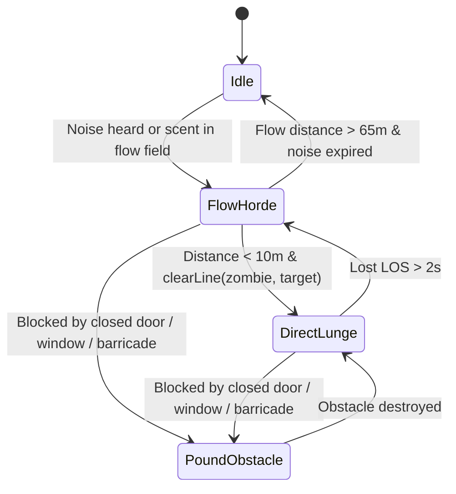

# Co-op Survival Plan (`games/outbreak`)

**Goal:** Build a co-op survival game for 2–8 friends in the spirit of *Project Zomboid*, rendered with Blackout's tactile 2.5D top-down WebGPU aesthetic and powered by the shared `@arcade/*` packages.

**Core Loop:** Drop into a procedural town with friends at dusk. Scavenge houses, shops, and car trunks for weapons, planks, nails, medical supplies, and fuel. Board up windows, wire a generator, manage noise (every gunshot, car engine, or broken window draws the horde), and survive the night. The world lives inside a SQLite-backed Cloudflare Durable Object so friends can disconnect and return to their fortified safehouse tomorrow.

---

## 1. Architecture and Mapping to Existing Code

```mermaid
flowchart LR
  subgraph Client["Browser Client (60 FPS WebGPU)"]
    Stream["Chunk Streamer (5x5 32m Chunks)"]
    Polar["Polar Shadow + Eye LOS (Slot 0)"]
    Fx["@arcade/fx (Fire Smoke, Rain, Splinters)"]
    Audio["AudioCore + Wall-Crossing Occlusion"]
  end

  subgraph Server["Room Durable Object (30 Hz Sim + SQLite)"]
    Flow["5 Hz Multi-Source Flow Field + Noise Grid"]
    Horde["Zombie SoA Pool (Wander / Flow / Lunge / Pound)"]
    Surv["Inventory, Loot, Vitals & Barricades"]
    SQLite["DO SQLite (chunks, players, vehicles)"]
  end

  Server -- "15 Hz Delta + 60m Interest" --> Client
  Client -- "30 Hz Player Intent" --> Server
```



### 1.1 World: Top-Down 2.5D Chunked Tiles, Blocks, and Streaming

**What we have today:**
- Blackout generates a complete `MapDef` (`games/blackout/shared/maps/types.ts:104-127`) for `office` or `downtown` (`games/blackout/shared/maps/downtown.ts`), builds 12×12 m static `LevelChunk` meshes (`games/blackout/src/render/level-mesh.ts:765-797`), and bakes two whole-map textures: `floorTex` (`rg8unorm`, 0.125 m/texel AO + moonlight, `level-mesh.ts:497-602`) and `bounceTex` (`rgba8unorm`, 0.5 m/texel Dijkstra indirect bounce, `level-mesh.ts:609-723`).
- Getaway partitions city geometry into 64×64 m AABB chunks (`games/getaway/src/render/city-mesh.ts:30-110`).

**What changes for survival:**
- **32×32 m World Chunks (`ChunkCoord = [cx, cz]`):** A town is anaddressed grid of 32×32 m chunks (e.g. an 8×8 chunk town = 256×256 m for the vertical slice, expandable to 32×32 chunks = 1 km²). Each chunk has a 1 m tile grid (`32×32` tiles) for floors/zones and a 0.5 m sub-grid (`64×64` cells) for walls, doors, windows, and navigation.
- **Deterministic Base + Sparse `ChunkDelta`:**
  - `generateBaseChunk(worldSeed, cx, cz)` deterministically produces the chunk's roads, yards, houses/shops (`Wall[]`, `Floor[]`, `Prop[]`, `LightDef[]`, `ContainerDef[]`) using `hash2(worldSeed, (cx << 16) | cz)` from `@arcade/sim/rng`. Unvisited or unmodified chunks require **zero storage bytes**.
  - A `ChunkDelta` records only mutations inside that chunk:
    ```ts
    export type OpeningState = { id: number; kind: "door" | "window"; open: boolean; smashed: boolean; planks: 0 | 1 | 2 | 3 | 4; hp: number }
    export type ContainerDelta = { id: number; seeded: boolean; items: ItemStack[] }
    export type BuiltProp = { id: number; kind: "crate" | "barricade" | "generator"; x: number; z: number; rot: 0 | 1 | 2 | 3; hp: number; fuel?: number; on?: boolean }
    export type ChunkDelta = {
      cx: number
      cz: number
      version: number
      openings: OpeningState[]
      containers: ContainerDelta[]
      built: BuiltProp[]
    }
    ```
- **Client Chunk Streaming & Incremental Mesh Rebuild:**
  - The client maintains a **5×5 chunk resident window** (`160×160 m`) centered on the local player.
  - Each resident chunk owns its GPU vertex buffer (`@arcade/gpu` 24-byte packed `Mesh`, split into `solid` and `cutaway` ranges so Apple GPUs keep early-Z hidden-surface removal on non-cutaway chunks, `docs/game-notes.md:84-86`) and its 64×64 tile in a toroidal 5×5 chunk floor/bounce texture array.
  - When a window shatters, a door swings open, or a player nails up a plank (`ChunkDelta.version` increments), only that single 32×32 m chunk rebuilds its mesh and updates its local `RectGrid` and `LightCuller` occluder cache (< 0.8 ms on CPU).

### 1.2 Visibility: Line of Sight and Three-State Fog of War

**What we have today:**
- Blackout's design (`games/blackout/docs/design.md:38-40, 116-120`) and renderer (`games/blackout/src/render/shaders.ts:61-130`) already cast `POLAR_RAYS = 720` rays per light slot in a WebGPU compute pass (`polarShader`), storing the first full-height wall hit (`full`) and the two nearest low-cover hits (`a, b` as `[enter, exit, height]`).

**How we turn polar shadows into Project Zomboid line of sight:**
1. **Polar Slot 0 is the Local Player's Eye:**
   - Every frame, `LightCuller` places a virtual sensor at **slot 0** at the local player's eye `(player.x, 1.6, player.z)` with radius `36 m`.
   - Crucially, `LightCuller` gathers **sight occluders** for slot 0 rather than movement solids: walls, closed doors, and 3–4 plank barricades block sight (`h = 2.8`), whereas glass windows, chain-link fences, low furniture (`h < 1.2`), and 1–2 plank gaps allow sight rays to pass!
2. **Directional Vision Cone + Peripheral Awareness:**
   - In `sceneShader`, every pixel evaluates `eyeVis = shadowAt(0u, eyePos, 1.6, 0.08, world.xz, world.y)`.
   - Multiply `eyeVis` by a field-of-view envelope: `1.0` inside a 110° cone around `player.aim` (softened over 18° at the edges) **or** within a `2.5 m` 360° close-awareness circle around the player's body (so a zombie grabbing you from behind is seen at the last moment, just like *Project Zomboid*).
3. **Three-State Fog of War:**
   - A persistent `Uint8Array` (1 bit per 1 m tile per chunk, saved in `localStorage` per room + player) records whether the player has ever seen each tile (`explored`).
   - **State 1 — Visible (`eyeVis > 0.05`):** Full direct + bounce lighting; dynamic entities (zombies, items, vehicles) are rendered.
   - **State 2 — Explored Shroud (`eyeVis <= 0.05` and `explored == 1`):** Static architecture (floors, walls, furniture) renders at `22%` brightness with `80%` desaturation and a cold navy tint (`vec3f(0.04, 0.06, 0.11)`). Dynamic actors (zombies, loot, non-allied movers) are **never drawn** in the shroud.
   - **State 3 — Unexplored (`explored == 0`):** Fades to near-black (`vec3f(0.004, 0.006, 0.014)`).
4. **Server-Side Enforcement (`shared/sim/view.ts`):**
   - Teammates always share positions (via walkie-talkie/co-op HUD markers), while zombies outside a player's `clearLine` sight cone are omitted from that viewer's snapshot unless they are within close hearing range (`3.5 m`) or emitting a loud noise ripple (thumping on a door/window).

### 1.3 Time and Weather: Day/Night Cycle and Rain/Fog

**What we have today:**
- Getaway has an orthographic directional moon shadow pass (`games/getaway/src/render/renderer.ts:451-494`, `shaders.ts:36-60`) and exponential distance fog (`shaders.ts:122-126`).
- Blackout has per-map sky ambient (`games/blackout/src/render/lighting.ts:47-50`), wet-asphalt specular puddles (`shaders.ts:445-455`), and `fx-kit` has velocity-stretched `water` particles (`packages/kit/fx/particles.ts:5, 12-15`) and `VolumeRenderer` (`volume-renderer.ts`).

**How the day/night and weather cycle works:**
- **`DayCycle` (`shared/sim/time.ts`):**
  - `world.dayTime` runs from `0.0` (00:00) to `24.0` (24:00). Default rate: `1 game hour = 60 real seconds` (`24 min` full day, tunable in `LabPanel`).
  - A piecewise-smooth keyframe table interpolates:
    - `sunDir: [x, y, z]` and `sunColor: [r, g, b, intensity]` (warm low-angle dawn at `06:00`, high noon at `12:00`, orange sunset at `19:00`, cold blue moonlight from `21:00–05:00`).
    - `skyAmbient: [r, g, b, outdoorBounce]`.
    - `gridPower`: Streetlamps and shop neon switch on automatically between `18:30` and `06:15` while the town power grid is active (or within `28 m` of a running player-fueled generator).
  - Indoor floor texels stay dark during the day except where window rays enter; outdoor tiles receive directional sun/moon light gated by building height shadows.
- **Weather State Machine (`clear` → `overcast` → `rain` → `storm` → `fog`):**
  - Driven deterministically by `world.rng`.
  - **`rain` / `storm`:** Spawns slanted `water` streaks in `@arcade/fx/particles` around the camera frustum, interpolates outdoor `wetness` (`0 → 1`) in the frame uniform so asphalt and sidewalks develop mirror puddles (`blackout/src/render/shaders.ts:450`), and raises `world.ambientNoiseRadius` (drowning out 8 m walk footsteps so players can move faster in the rain, while thunder flashes briefly illuminate the map and emit a 60 m noise event).
  - **`fog`:** Narrows maximum sight radius from `36 m` to `18 m` and increases distance fog density.

### 1.4 Zombies: Cheap Horde AI at Scale Using Flow Fields and Noise Attraction

**What we have today:**
- `games/blackout/shared/sim/nav.ts:218-241` already implements a zero-allocation `Int32Array` ring-queue BFS (`distances()`) over a `0.5 m` walkable grid.
- `fx-kit/packages/kit/fx/volume.ts:50-60` implements a 4-connected wall-respecting BFS flood fill.
- `getaway-clutter/games/getaway/src/game/props/physics.ts:11-35` implements `SpatialHash`.
- `games/blackout/docs/design.md:46-60` defines the noise ripple radius table (walk 8 m, run 18 m, suppressed pistol 14 m, shotgun 40 m, door slam 16 m, glass break 30 m).

**How we simulate 300–500 zombies in < 1.2 ms per 30 Hz server tick:**



1. **Struct-of-Arrays (SoA) Zombie Pool (`shared/sim/zombies.ts`):**
   - Up to `MAX_ZOMBIES = 512` active zombies stored in flat typed arrays (`x`, `z`, `vx`, `vz`, `h`, `hp`, `state`, `targetId`, `attackCool`, `seed`) — zero GC pressure.
2. **Multi-Source Dijkstra Flow Field (`@arcade/sim/nav`):**
   - Instead of running A* per zombie, the server maintains a `1 m` resolution flow grid (`128×128` cells = `16,384` cells covering the active play area around players).
   - Every **6 ticks (5 Hz)**, we seed the Dijkstra queue with:
     - Every living human player's cell at distance `0`.
     - Every active **Noise Attractor** `(nx, nz, radius, age, maxAge)` at initial cost `max(0, 35 - radius * 0.6)` so a `45 m` shotgun blast pulls zombies from across the neighbourhood toward the shot's origin even after the shooter sneaks away!
   - Closed doors and barricaded windows have traversal cost `+6` (instead of `BLOCKED`), so the flow field routes zombies **to** the doors and windows of a safehouse when no open path exists.
   - A 16,384-cell BFS/bucket-queue pass in V8 takes **~0.14 ms** every 200 ms.
3. **Per-Tick Zombie Step (30 Hz):**
   - **Far (> 10 m or no LOS):** Sample the flow field's 4-neighbor gradient `(gx, gz)`, add a small seeded wander curl so hordes don't march in single file, apply O(1) neighbor repulsion from `SpatialHash` (`radius = 0.38 m`), and call `pushOut` against `World.solids`.
   - **Near (< 10 m with `clearLine` LOS):** Steer directly toward the visible player at `1.9 m/s` (shamblers) or `3.6 m/s` (sprinters, Lab/room option); within `0.85 m`, lunge and bite/scratch.
   - **Pounding:** When a zombie's flow step pushes it against a closed door, window, or barricade, it enters `PoundObstacle`, dealing structural damage every `1.2 s` and emitting a `10 m` thud ripple (which attracts nearby zombies to the same breach point).

### 1.5 Survival Systems: Inventory, Items, Crafting, Barricades, and Base Building

**What we have today:**
- Blackout's `Kit` (`games/blackout/shared/sim/kit.ts`), melee wind-up/hit arc (`shared/sim/melee.ts`), weapon firing/reload (`shared/sim/world.ts`), and 4-seat drivable vehicles (`shared/sim/vehicle-rules.ts`).

**Minimal, high-leverage survival mechanics:**
1. **Compact Slot Inventory (8 Pack Slots + Primary + Secondary + Flashlight):**
   - No nested micro-grids. Each player has `primary` (two-handed weapon: bat, axe, shotgun, rifle), `secondary` (one-handed: crowbar, hammer, pistol, knife), `light` (flashlight toggle `F`), and `pack: ItemStack[8]`.
   - Total carried weight above `12 kg` applies a linear speed/stamina multiplier (`0.75×` at `20 kg`), reusing `slowCarrier` from `games/blackout/shared/sim/modes-objective.ts`.
   - Vehicle trunks (`jeep` holds 12 slots, `van` holds 24 slots) and world furniture (`desk`, `cabinet`, `fridge`, `shelf`, `crate`) use the exact same `ItemStack[]` container format.
2. **Core Item & Crafting Table (6 Recipes, Instant or 2s Timed Progress Bar):**
   | Output | Inputs | Tool Required | Use |
   | --- | --- | --- | --- |
   | **Barricade Plank (×1–4)** | `1× Plank + 1× Nails` | `Hammer` (in inventory) | Hold `E` at any window or doorway to nail up to 4 planks (+120 HP each) |
   | **Sheet Backup** | `1× Ripped Sheet` | — | Tear clothing into bandages to stop `bleeding` |
   | **Sterile Bandage** | `1× Sheet + 1× Disinfectant` | — | Stops `bleeding` and lowers wound infection risk |
   | **Spiked Bat** | `1× Baseball Bat + 4× Nails` | `Hammer` | Higher melee damage and knockback |
   | **Molotov** | `1× Bottle + 1× Fuel + 1× Sheet` | — | Reuses `stepGrenade` (`gear.ts:83`); spawns fire + `SmokeVolumes` plume on impact |
   | **Wooden Crate** | `3× Plank + 3× Nails` | `Hammer` | Placeable 12-slot storage box + low cover (`h = 0.85`) |
3. **Vitals:**
   - `hp` (0..100), `stamina` (0..100, drained by sprinting and melee swings, recovers when walking/standing), `bleeding` (HP drain/s from zombie lacerations until bandaged), `hunger` (0..100, slow drain over 20 min), and `bitten` (fatal zombification timer that turns the player's corpse into a reanimated zombie on death!).

### 1.6 Persistence: Durable Object SQLite World Storage and Snapshots

**What we have today:**
- Both `games/getaway/wrangler.jsonc:26` and `games/blackout/wrangler.jsonc:26` already declare `new_sqlite_classes: ["Room"]`.
- `games/blackout/server/lobby.ts:14-23` uses `ctx.storage` with `blockConcurrencyWhile`.

**How persistent survival rooms work in `@arcade/server`:**
- In `RoomDO.constructor`, `ctx.blockConcurrencyWhile` initializes four SQLite tables via `ctx.storage.sql.exec(...)`:
  ```sql
  CREATE TABLE IF NOT EXISTS world_meta (
    id INTEGER PRIMARY KEY CHECK (id = 1),
    seed INTEGER NOT NULL,
    tick INTEGER NOT NULL,
    day_time REAL NOT NULL,
    weather TEXT NOT NULL,
    updated_at INTEGER NOT NULL
  );
  CREATE TABLE IF NOT EXISTS chunks (
    cx INTEGER NOT NULL,
    cz INTEGER NOT NULL,
    version INTEGER NOT NULL,
    delta_json TEXT NOT NULL,
    PRIMARY KEY (cx, cz)
  );
  CREATE TABLE IF NOT EXISTS players (
    id TEXT PRIMARY KEY,
    name TEXT NOT NULL,
    x REAL NOT NULL,
    z REAL NOT NULL,
    aim REAL NOT NULL,
    vitals_json TEXT NOT NULL,
    inventory_json TEXT NOT NULL,
    updated_at INTEGER NOT NULL
  );
  CREATE TABLE IF NOT EXISTS vehicles (
    id INTEGER PRIMARY KEY,
    kind TEXT NOT NULL,
    x REAL NOT NULL,
    z REAL NOT NULL,
    h REAL NOT NULL,
    hp REAL NOT NULL,
    fuel REAL NOT NULL,
    trunk_json TEXT NOT NULL
  );
  ```
- **Dirty-Set Checkpointing (Zero Per-Tick I/O):**
  - The simulation runs 100% in memory at 30 Hz. Mutating a door, barricade, or container marks `dirtyChunks.add(key)`.
  - Every **10 seconds** (and immediately when any player disconnects), a single synchronous SQLite transaction writes `world_meta`, all `dirtyChunks`, active `players`, and `vehicles` (< 1 ms in workerd SQLite).
- **Zero-Cost Hibernation When Friends Log Off:**
  - When the last human disconnects, `RoomDO` flushes all dirty state to SQLite, stops the 30 Hz `setInterval`, unregisters from the public `LobbyDO` active list, and keeps the SQLite database intact.
  - When friends reconnect to `?room=OAK1` days later, `RoomDO` hydrates `world_meta`, `chunks`, `vehicles`, and each returning player's `players` row by their persistent token, resuming at the exact minute, barricade state, and inventory where they left off.
- **Snapshot Export/Import (`/api/room/:code/snapshot`):**
  - `GET /api/room/:code/snapshot` dumps `{ meta, chunks, vehicles }` as a single JSON file so a group can save backups or attach a deterministic repro to a bug report.

### 1.7 Netcode: 2–8 Player Co-op, Interest Management, and Delta Snapshots

**What we have today:**
- `perf-proposals/scripts/perf/network.ts` and `codecs.ts` already prototyped and verified `delta(before, after)`, `apply(before, patch)`, `Binary` string-dictionary encoding, and `60 m` per-recipient radius filtering across Getaway and Blackout.

**How co-op netcode scales to 300+ zombies and chunk deltas:**
1. **Per-Viewer 60 m Interest Bubble (`shared/sim/view.ts`):**
   - Each connected player only receives:
     - All human teammates (always included so co-op map/radio works across town).
     - Zombies within `60 m` of the viewer (or within `60 m` of a spectated teammate) that are either in `clearLine` LOS, within `3.5 m` hearing range, or actively pounding an obstacle.
     - `ChunkDelta` updates only for chunks in the viewer's 5×5 resident window whose `version > viewerLastChunkVersion.get(chunkKey)`.
2. **Quantized Zombie Wire Format + Delta Encoding (`@arcade/protocol`):**
   - Active zombies in view serialize as compact tuples `[id, qx, qz, qh, state, hp]` where `qx = Math.round(x * 20)` (5 cm precision), `qz = Math.round(z * 20)`, and `qh = Math.round((h / (2 * Math.PI)) * 256) & 255`.
   - Combined with `@arcade/protocol`'s `delta()` against the last snapshot tick acknowledged by that client (`msg.ackSnap`), stationary/unchanged entities send **0 bytes**, keeping 15 Hz snapshots under **2.5 KB/s per player** even during a 100-zombie siege.

### 1.8 Feel: Raycast Audio Occlusion and Shared FX/Smoke

**What we have today:**
- `games/blackout/src/audio/sound.ts:79-97` creates a per-voice `GainNode` → `BiquadFilterNode` (lowpass) → `StereoPannerNode` → master + `ConvolverNode` reverb send.
- `fx-kit/packages/kit/fx/` provides `SmokeVolumes` + `VolumeRenderer` (48×48 @ 0.5 m flood-fill smoke that respects walls and doors, plus bullet/explosion `carve()`) and `Particles` + `ParticleRenderer` (sparks, debris, water, fire).
- `getaway-clutter` provides `PropPhysics` (120 Hz client-side rigid bodies for knocked-over street props).

**How we wire them for survival tension:**
1. **Wall-Crossing Audio Occlusion (`@arcade/client/audio`):**
   - Before playing any spatial sound at `(sx, sz)`, count how many walls/closed doors intersect the segment from `(listener.x, listener.z)` to `(sx, sz)` using `@arcade/sim/geom`'s `RectGrid` (`countWallCrossings(lx, lz, sx, sz, walls)`):
     ```ts
     const distCutoff = 22000 / (1 + dist * 0.18)
     const occlusionCutoff = distCutoff * Math.pow(0.42, wallCrossings) // 1 wall -> 42%, 2 walls -> 17%
     lowpass.frequency.value = Math.max(220, Math.min(20000, occlusionCutoff))
     reverbSend.gain.value = baseWet * Math.min(2.8, (1 + dist * 0.05) * (1 + wallCrossings * 0.45))
     ```
   - **Result:** Zombies groaning and thumping outside a boarded bedroom sound muffled, booming, and claustrophobic (`~600 Hz` lowpass); the instant a window shatters (`wallCrossings` drops by 1), the high-frequency glass crunch and snarls snap into sharp focus.
2. **Fire, Flood-Fill Smoke, and Debris (`@arcade/fx`):**
   - Molotovs, stove fires, and wrecked vehicles spawn `SmokeVolumes` (`volume.ts:31`) and `fire` particles. Smoke floods through open interior doorways and stops at closed doors and boarded windows; firing a shotgun through a smoke-filled hallway carves a temporary 0.7 s sightline tunnel (`volume.ts:65`).
   - Smashing a window or breaking a plank barricade spawns `debris` shards in `Particles` with surface-appropriate bounce and clink audio (`sound.ts:256`).

---

## 2. Vertical Slice Plan ("Night One in Oakridge") vs. Deferred Scope

### 2.1 Vertical Slice Scope (What to Build First)

The vertical slice proves every shared seam end-to-end in one tense, replayable 15-minute session for 1–4 players:

1. **Map:** A 3×3 chunk (`96×96 m`) suburban-commercial intersection generated from Blackout's downtown/office kit:
   - 1 hardware store (crowbars, hammers, planks, nails, flashlights).
   - 1 convenience store / pharmacy (bandages, disinfectant, canned food, water).
   - 1 police cruiser + 1 drivable 4-seat van parked on the street (`@arcade/sim/vehicle`).
   - 2 residential houses with bedrooms, kitchens, backyards, and a portable generator in a shed.
2. **Clock & Lighting:** Starts at **18:00 (dusk)**. Sun sets over 4 real minutes into pitch night (`21:00`); streetlamps flicker and fail at `22:00` unless the players fuel and start the safehouse generator. Polar slot 0 drives the player's line-of-sight shroud + flashlight cone; slots 1..47 drive lamps, headlights, muzzle flashes, and Molotov fires.
3. **Enemies:** 120 zombies distributed across the 9 chunks (shamblers by day, more aggressive at night), driven by the 5 Hz flow field and attracted by gunshots, car horns, generator hum, and window smashes.
4. **Survival & Co-op Actions:**
   - Scavenge containers (`E` opens a clean 8-slot loot drawer).
   - Equip crowbar/bat (`1`), pistol/shotgun (`2`), flashlight (`F`), bandage (`3`), or Molotov (`G`).
   - Nail planks onto windows/doors (`Hold E` with hammer + planks + nails) and repair them while zombies pound outside.
   - Drive the 4-seat van Together (driver steers, passengers shoot out the windows, trunk holds shared loot).
   - Automatic SQLite checkpointing in `RoomDO` so refreshing the browser or reconnecting to `?room=CODE` restores player vitals, inventory, barricades, and world clock.

### 2.2 Five-Milestone Build Sequence for the Slice

| Milestone | Deliverable | Proof |
| --- | --- | --- |
| **M1. Chunked Map + Eye LOS Shroud** | `games/outbreak/` scaffolded on `@arcade/gpu`, `@arcade/sim`, `@arcade/client`. 3×3 chunk town renders with polar slot 0 LOS cone + 3-state fog of war + `DayCycle` dusk-to-night slider in `LabPanel`. | `bun test` + Metal screenshot proof of visible vs. explored-shroud vs. unexplored rooms at noon, dusk, and midnight. |
| **M2. Flow-Field Horde + Noise Ripples** | 150 zombies in SoA pool following 5 Hz Dijkstra flow field + noise attractors (footsteps, gunshots, window smashes) + door/window pounding. | Unit test: 300 zombies step in < 1.5 ms; noise attractor pulls zombies through a doorway around a sealed wall. |
| **M3. Containers, Inventory, Vitals & Barricades** | Loot containers, 8-slot pack, bleeding + bandaging, and hammer-and-plank window/door barricading that updates `ChunkDelta`, `RectGrid`, and `LightCuller`. | Deterministic sim test: nail 3 planks -> zombie pounds through in N ticks -> LOS and movement blocked until planks break. |
| **M4. Co-op Netcode + DO SQLite Persistence** | `@arcade/server` `RoomDO` with SQLite tables (`world_meta`, `chunks`, `players`, `vehicles`), 60 m interest filter, and `@arcade/protocol` delta snapshots. | Multi-client test: 4 players scavenge and barricade, disconnect, restart `RoomCore` from SQLite, and verify identical restored state. |
| **M5. Audio Occlusion, Fire Smoke & Van Escape** | Raycast wall-count audio lowpass, Molotov + `SmokeVolumes` room-flooding fire/smoke, and 4-seat van with trunk storage. | Paired Metal benchmark + `compare-video` capture of a 4-player night siege. |

### 2.3 Explicitly Deferred (Out of Scope for Vertical Slice)

Do **not** build these until the vertical slice is playtested and proven fun:
- **Multi-storey roofs and stair transitions:** Keep the vertical slice on a single ground plane (`y = 0` with `2.8 m` walls and cutaway roofs), matching Blackout's proven 2.5D polar shadow assumptions.
- **Farming, cooking, fishing, and nutrition macros:** Simple canned food/water items are enough for the slice.
- **RPG skill trees, trait point-buy menus, and carpentry leveling:** Every survivor can swing a hammer, fire a gun, and drive a van from minute one.
- **Human NPC raiders and dialogue trees:** Threats come from the horde, noise management, darkness, and resource scarcity.
- **Infinite world streaming:** A 3×3 (96×96 m) or 5×5 (160×160 m) town is plenty for 2–8 friends until the core siege loop sings.
